# HireScan — Enterprise Test Management & Assessment Platform

[](https://www.djangoproject.com/)
[](https://www.python.org/)
[](https://getbootstrap.com/)
[](https://www.postgresql.org/)
[](https://www.docker.com/)
[-success?style=for-the-badge&logo=pytest&logoColor=white)](https://github.com/Ayush7kr/hire-scan)
[](LICENSE)

HireScan is a secure, high-performance, enterprise-grade technical assessment and test management tool. Engineered with Django and Python, HireScan automates candidate onboarding, conducts timed, randomized examinations with zero answer leakage, and delivers executive psychometric and competency analytics.

---

## 📸 Platform Visual Showcase

### Adaptive Modern Theme (Light & Dark Mode)
HireScan includes an eye-friendly, high-contrast theme system with a centralized toggle in the top navigation header across all pages.

| Light Mode Interface | Dark Mode Interface |
| :---: | :---: |
|  |  |

---

### Core User Experiences

| Candidate Passwordless OTP Sign-In | Administrator Secure Sign-In |
| :---: | :---: |
|  |  |
| *Cryptographic 6-digit email OTP with PBKDF2 hashing, 5-minute TTL, responsive HTML template & anti-enumeration.* | *Dedicated, isolated admin gateway with CSRF defense, session protection, and role-based access.* |

---

### Administrator Operations & Live Audit Stream

| Executive Dashboard with Independent Scroll Stream | Candidate Directory & Status Control |
| :---: | :---: |
|  |  |
| *Real-time KPI metrics with an independently scrollable live audit activity log and 2-line authenticated footer.* | *Candidate directory with multi-field search, active/inactive filters, and instant status toggling.* |

---

### Assessment Lifecycle Tracking & Schedule Windows

| Tests Roster with 5 Lifecycle Statuses | Test Detail, Schedule Window & Cancellation |
| :---: | :---: |
|  |  |
| *Track tests across 5 lifecycle statuses: Scheduled, Upcoming, In Progress, Completed, and Cancelled with instant filtering.* | *Detailed inspection of test parameters, start/end schedule windows, sufficiency validation, and cancellation toggle.* |

---

### Candidate Registration: Single & High-Capacity Bulk Operations

| Bulk Candidate Registration with Review Tray | Test Registrations with Multi-Parameter Filters |
| :---: | :---: |
|  |  |
| *Tabbed registration: candidate checkboxes, live search filter, select-all, count badge, and dismissible candidate review chips.* | *Search by candidate or test name, filter by test, registration status, and attempt completion state.* |

---

### Assessment Creation & Question Bank Curation

| Candidate Bulk CSV Import Wizard | Assessment Configuration Wizard |
| :---: | :---: |
|  |  |
| *Atomic batch onboarding with validation, deduplication, and downloadable error reports.* | *Configure countdown timers, question pools, passing thresholds, and start/end schedule windows.* |

| Question Bank Management | Bulk Question CSV Import Wizard |
| :---: | :---: |
|  |  |
| *4-option MCQs with topic tagging, difficulty ratings, and contextual recommendations.* | *Rapid question onboarding via CSV template with automatic format normalization.* |

---

### Candidate Assessment Audit & Executive Analytics Suite

| Granular Candidate Attempt Inspection | Test Summary & Cohort Benchmarks |
| :---: | :---: |
|  |  |
| *Per-question breakdown, autosave timestamps, selected vs. correct options, and PDF scorecard export.* | *Cohort-level pass rates, score distributions, median/average benchmarks, and performance trends.* |

| Question Difficulty & Discrimination Analysis | Topic Competency & Skill Gap Breakdown |
| :---: | :---: |
|  |  |
| *Item-response psychometrics, accuracy percentages, and top-tier discrimination index.* | *Domain proficiency radar mapping strengths and weaknesses across candidate pools.* |

---

## 📚 Comprehensive Documentation Suite

Dive deeper into every facet of HireScan with our dedicated guides:

- 📖 **[Administrator Operations Guide](docs/ADMIN_GUIDE.md)**: Complete manual covering candidate onboarding, test creation, question banks, registrations, attempt inspection, and analytics.
- 🎓 **[Candidate Examination Guide](docs/CANDIDATE_GUIDE.md)**: Walkthrough of the candidate journey, OTP authentication, exam rules, autosave behavior, and scorecards.
- 🏛️ **[System Architecture & Technical Specifications](docs/ARCHITECTURE.md)**: Deep dive into the modular architecture, Entity Relationship (ER) diagrams, transaction isolation, state machine, and database indexes.
- 🔒 **[Security Architecture & Threat Model](docs/SECURITY.md)**: Details on PBKDF2 OTP hashing, Zero-Answer-Leak design, anti-enumeration, session security, and HTTP security headers.
- 🚀 **[Production Deployment & Operations Guide](docs/DEPLOYMENT_GUIDE.md)**: Step-by-step instructions for Docker, Docker Compose, PostgreSQL 16, Gunicorn WSGI, WhiteNoise, backups, and CI/CD.

---

## ⚡ Key Highlights & Core Features

- **No Django Admin Dependency:** All administrative tools and workflows are custom-built with targeted business logic, responsive UI, and granular auditing.
- **Strict Role Separation & Authenticated Footer:**
  - **Administrators:** Provisioned via secure CLI, protected by PBKDF2 password hashing and HTTP-only session cookies.
  - **Candidates:** 100% passwordless authentication via cryptographic 6-digit email OTPs with 5-minute TTL, 60s cooldown, and 3-attempt invalidation.
  - **Branded Session Footer:** Uniform 2-line authenticated footer (`© 2026 HireScan Test Management Tool. All rights reserved.` / `Secure Session Authentication • Role-Based Access Control`) across all logged-in views in both light and dark themes.
- **Dynamic 5-Status Test Lifecycle Tracking:**
  - Tests dynamically transition between **Scheduled**, **Upcoming**, **In Progress**, **Completed**, and **Cancelled** based on schedule windows (`start_time`, `end_time`), activation state, and cancellation flags.
  - Candidate eligibility gating prevents launching upcoming, expired, or cancelled assessments.
  - One-click administrator cancellation toggle with immediate audit logging.
- **Dual-Mode Candidate Registration (Single & High-Capacity Bulk):**
  - Seamlessly select and register single candidates or onboard multiple candidates simultaneously.
  - Interactive multi-select UI with live search, select-all/deselect-all helpers, selection counters, and dismissible candidate review chips.
  - Atomic database transactions (`transaction.atomic()`), duplicate detection, and transparent reporting of created, existing, and rejected candidates.
- **Server-Side Multi-Field Search & Dynamic Filtering:**
  - **Candidates:** Search by name, email, phone/WhatsApp, and college; filter by Active/Inactive status.
  - **Tests:** Search by title and description; filter across all 5 test statuses.
  - **Registrations:** Search by candidate name/email and test name; filter by test, registration status, and attempt status.
  - Preserves search and filter parameters across pagination via URL query string encoding.
- **Professional Branded OTP Email System:**
  - Clean, responsive HTML email template with HireScan branding, high-visibility OTP display box, local expiry notice, and security warnings.
  - Full plain-text fallback for maximum client compatibility.
  - Strict confidentiality: OTPs are never exposed in application logs or client payloads.
- **Zero-Answer-Leak Architecture:** Correct answers are **never** delivered to client browsers during assessments. Scoring occurs strictly server-side within atomic database transactions.
- **Resilient Assessment Engine:**
  - Automated question randomization and stable per-attempt ordering.
  - Non-blocking asynchronous answer autosaving (`/test/autosave/<attempt_id>/`).
  - Server-authoritative timer deadline enforcement (`start_time + duration`).
  - Idempotent finalization handling both manual submissions and automatic timeouts.
- **Question Sufficiency Rule:** Tests cannot be activated unless the question bank contains at least `total_questions`, preventing examinee disruptions.
- **5-Module Analytics Engine:**
  - **Test Summaries:** Cohort pass rates, average scores, and distributions.
  - **Candidate Performance:** Individual attempt rankings, percentiles, and completion times.
  - **Question Item Analysis:** Psychometric accuracy percentages and discrimination indices.
  - **Topic Competency:** Domain skill gap breakdown.
  - **Assessment Pipeline:** Candidate progression funnel from registration to submission.
- **Export Capabilities:**
  - Official branded Candidate Scorecard PDF generation powered by ReportLab.
  - Batch CSV exports protected against spreadsheet formula injection (`=`, `+`, `-`, `@`).
- **Production-Ready Operations:**
  - Multi-stage `Dockerfile` running as non-root user (`hirescan`).
  - `docker-compose.yml` orchestrating PostgreSQL 16 and Gunicorn WSGI.
  - Automated health check probes (`/health/`, `/healthz/`).
  - GitHub Actions CI workflow executing linting, PostgreSQL migrations, and 176 automated tests.

---

## 🚀 Mentor-Approved Platform Enhancements

HireScan features six major institutional enhancements:

1. **Email Notifications & Automated Reminders:**
   - Branded HTML notifications with plain-text fallback for enrollment, test availability, and cancellations.
   - Background automated examination reminders via `python manage.py send_assessment_reminders --hours=24`.
   - Idempotent `NotificationLog` tracking preventing duplicate dispatches.
2. **Bulk Registration Summary Screen:**
   - Post-registration summary screen with KPIs (Total Selected, Created, Already Registered, Rejected/Invalid).
   - Detailed candidate breakdown tables specifying exact conflict or validation reasons.
3. **Comprehensive Audit Logging & Stream UI:**
   - Granular event capture for question authoring, CSV/PDF exports, examinee lifecycle, and unauthorized attempts.
   - Categorized badges (Security, Examination, Authoring, Reporting) with actor attribution in an independently scrollable feed.
4. **Advanced Assessment Analytics & Psychometrics:**
   - Item-level Facility Index ($P$) and Discrimination Index ($D$) psychometrics.
   - Statistical distribution metrics: median score, score range, standard deviation, and score quadrant brackets.
   - Candidate cross-assessment competency profiling tracking score history, timelines, and demonstrated topic strengths vs. focus areas.
5. **Assessment Integrity & Tamper-Evident Defenses:**
   - Server-authoritative timer enforcement preventing client clock tampering.
   - Mid-flight cancellation guards immediately halting autosaving or submissions on revoked tests.
   - Strict session and IDOR defense with activity logging for unauthorized probes.
6. **Automated Executive Report Generation:**
   - Assessment Summary ReportLab PDF exports with institutional KPIs, statistical distributions, score brackets, topic breakdowns, and uniform 2-line security footers.
   - Filter-scoped Candidate Results PDF exports for executive review and spreadsheet correlation.

---

## 🛠️ Technology Stack

| Layer | Technology |
| :--- | :--- |
| **Backend Framework** | Python 3.12 LTS & Django 4.2 LTS |
| **Database** | PostgreSQL 16 (Production) / SQLite (Local Development) |
| **Frontend & UI** | HTML5, Modern CSS3, Vanilla JavaScript (ES6+), Bootstrap 5.3, Bootstrap Icons |
| **Charts & Visuals** | Chart.js 4.4 (Offline-bundled via WhiteNoise) |
| **PDF Generation** | ReportLab |
| **WSGI Server** | Gunicorn with thread workers |
| **Static Assets** | WhiteNoise (`CompressedManifestStaticFilesStorage`) |
| **Containerization** | Docker, Docker Compose |
| **CI/CD** | GitHub Actions |

---

## 🗄️ Database Schema & Entity Relationships

```mermaid
erDiagram
    ADMIN {
        uuid admin_id PK
        string email UK
        string password_hash
        string name
        boolean is_active
        datetime created_at
    }

    CANDIDATE {
        uuid candidate_id PK
        string email UK
        string name
        string phone
        string college
        boolean is_active
        datetime created_at
    }

    OTP_VERIFICATION {
        uuid otp_id PK
        string email
        string otp_hash
        datetime expires_at
        int attempts_left
        boolean is_used
        datetime created_at
    }

    TEST {
        uuid test_id PK
        string test_name
        text description
        int duration_minutes
        int total_questions
        int passing_marks
        boolean is_active
        datetime start_time
        datetime end_time
        boolean is_cancelled
        datetime created_at
    }

    QUESTION {
        uuid question_id PK
        uuid test_id FK
        text question_text
        string option1
        string option2
        string option3
        string option4
        int correct_option
        string topic
        string difficulty
        text suggestions
    }

    TEST_REGISTRATION {
        uuid registration_id PK
        uuid candidate_id FK
        uuid test_id FK
        string status
        datetime registered_at
    }

    TEST_ATTEMPT {
        uuid attempt_id PK
        uuid registration_id FK,UK
        string status
        datetime start_time
        datetime end_time
        int score
        int total_questions
        int correct_answers
        int incorrect_answers
        int unanswered
        decimal percentage
        boolean is_passed
        int time_taken_seconds
        string submission_reason
    }

    ATTEMPT_QUESTION {
        uuid aq_id PK
        uuid attempt_id FK
        uuid question_id FK
        int question_order
        int selected_option
        boolean is_correct
        datetime answered_at
    }

    CANDIDATE ||--o{ TEST_REGISTRATION : "is registered for"
    TEST ||--o{ TEST_REGISTRATION : "has candidate registrations"
    TEST ||--o{ QUESTION : "contains question bank"
    TEST_REGISTRATION ||--o| TEST_ATTEMPT : "has single attempt"
    TEST_ATTEMPT ||--o{ ATTEMPT_QUESTION : "contains assigned questions"
    QUESTION ||--o{ ATTEMPT_QUESTION : "appears in"
```



---

## 🚀 Quickstart & Local Installation

### Prerequisites
- Python 3.10 to 3.12 (Tested on Python 3.12)
- Git

### 1. Clone & Enter Repository
```bash
git clone https://github.com/Ayush7kr/hire-scan.git
cd hire-scan
```

### 2. Create & Activate Virtual Environment
```bash
# On Windows (PowerShell):
python -m venv venv
.\venv\Scripts\Activate.ps1

# On Linux / macOS:
python3 -m venv venv
source venv/bin/activate
```

### 3. Install Dependencies
```bash
pip install -r requirements.txt
```

### 4. Configure Environment Variables
Copy `.env.example` to `.env`:
```bash
cp .env.example .env
```
*(In local development with `DEBUG=True`, Django prints candidate OTP emails directly to your terminal console).*

### 5. Run Database Migrations
```bash
python manage.py migrate
```

### 6. Provision Initial System Administrator
```bash
python manage.py create_admin \
    --email admin@hirescan.local \
    --name "System Administrator" \
    --password "SuperSecretPassword123!"
```

### 7. Run Automated Tests
```bash
python manage.py test
```

### 8. Start Development Server
```bash
python manage.py runserver
```

Open `http://127.0.0.1:8000/` in your browser.

---

## 🧪 Automated Test Suite

HireScan includes a comprehensive test suite with 100% pass rate across 131 tests:

```bash
python manage.py test
```

```text
Found 131 test(s).
Creating test database for alias 'default'...
System check identified no issues (0 silenced).
...................................................................................................................................
----------------------------------------------------------------------
Ran 131 tests in 130.541s

OK
Destroying test database for alias 'default'...
```

### Test Coverage Highlights
- **Authentication & Security:** PBKDF2 hashing, OTP generation, cooldown throttling, brute-force invalidation, anti-enumeration, session fixation protection.
- **Authorization & RBAC:** Route security gating via `@admin_required` and `@candidate_required`, preventing unauthorized or cross-tenant access.
- **Data Integrity:** Question bank sufficiency rules, registration uniqueness, single-attempt locks, and cascade behaviors.
- **Assessment Engine:** Dynamic question allocation, autosave idempotency, server-side timer enforcement, and atomic evaluation.
- **Analytics & Exports:** Formula injection protection, mathematical ranking accuracy, and ReportLab scorecard PDF integrity.

---

## 🚢 Docker Production Deployment

HireScan is fully containerized and production-ready with Docker Compose:

```bash
# 1. Build and boot services in detached mode
docker compose up -d --build

# 2. Apply database migrations inside container
docker compose exec web python manage.py migrate --noinput

# 3. Create production administrator account
docker compose exec web python manage.py create_admin \
    --email admin@yourdomain.com \
    --name "System Administrator" \
    --password "SecureProductionPassword123!"

# 4. Check container health status
curl -I http://localhost:8000/health/
```

For complete deployment details including Nginx configuration, SSL termination, and PostgreSQL backup automation, refer to the **[Production Deployment Guide](docs/DEPLOYMENT_GUIDE.md)**.

---

## 📄 License

This project is licensed under the MIT License — see the [LICENSE](LICENSE) file for details.
