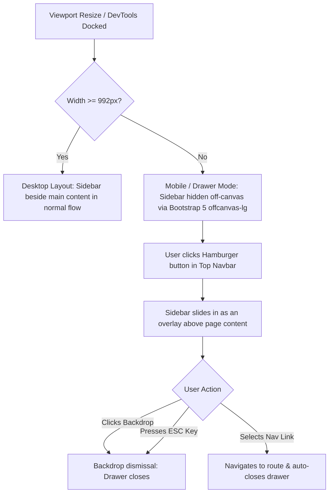
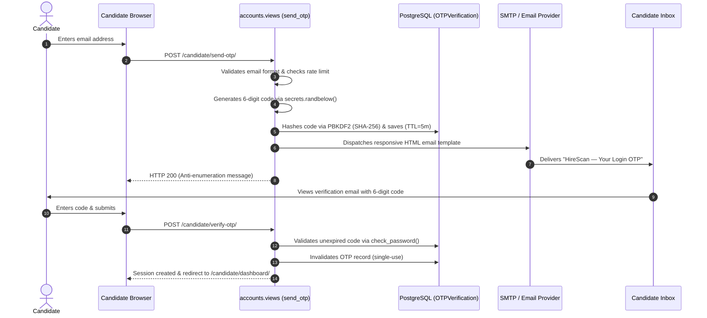
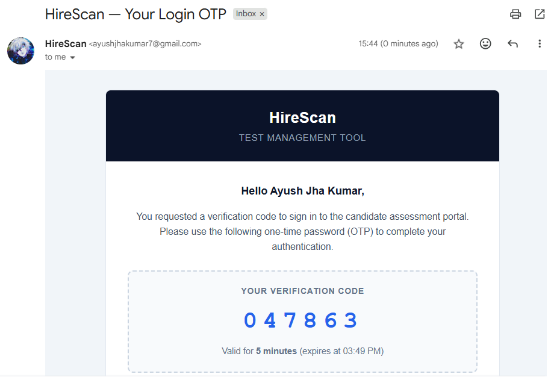
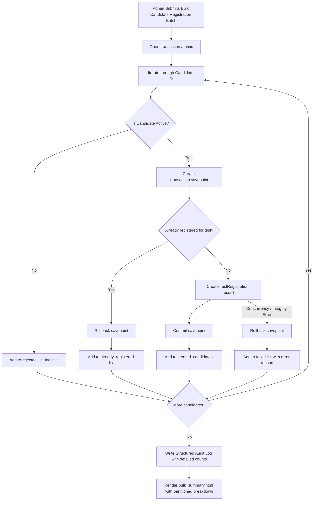
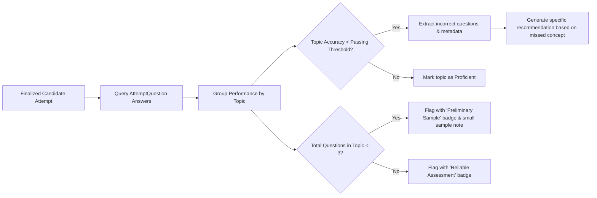
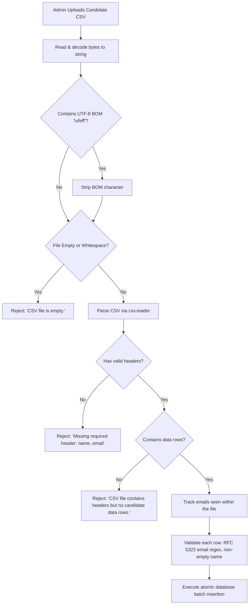

# HireScan — Advanced & Additional Features Specification

This document provides a comprehensive technical and operational specification of the advanced and additional features implemented in **HireScan — Test Management & Assessment Platform**. These features extend the core evaluation engine with responsive off-canvas UI architecture, robust bulk candidate registration with conflict isolation, statistically sound PDF cohort reporting, dynamic question-level scorecard recommendations, and multi-layered CSV data validation.

---

## Table of Contents
1. [Feature Summary & Capability Matrix](#1-feature-summary--capability-matrix)
2. [Responsive Multi-Device Layout & Off-Canvas Admin Navigation Drawer](#2-responsive-multi-device-layout--off-canvas-admin-navigation-drawer)
3. [Passwordless Candidate OTP Authentication & Branded Inbox Delivery](#3-passwordless-candidate-otp-authentication--branded-inbox-delivery)
4. [High-Capacity Bulk Registration Engine with Conflict Isolation](#4-high-capacity-bulk-registration-engine-with-conflict-isolation)
5. [Official Assessment Summary PDF with Statistical Sample Safeguards](#5-official-assessment-summary-pdf-with-statistical-sample-safeguards)
6. [Curated Candidate Scorecard & Dynamic Topic Recommendation Engine](#6-curated-candidate-scorecard--dynamic-topic-recommendation-engine)
7. [Resilient Candidate CSV Import Engine with Multi-Layered Validation](#7-resilient-candidate-csv-import-engine-with-multi-layered-validation)
8. [Automated Test Suite & Quality Verification](#8-automated-test-suite--quality-verification)

---

## 1. Feature Summary & Capability Matrix

| Feature Module | Target Audience | Primary Technical Components | Key Capabilities & Defenses |
| :--- | :--- | :--- | :--- |
| **Responsive Off-Canvas Navigation** | Administrators / Proctors | `templates/admin_portal/includes/sidebar.html`, `static/css/style.css`, `static/js/main.js` | Collapses desktop sidebar into an off-canvas drawer on screens `< 992px` or docked DevTools. Backdrop dismissal, Escape listener, link auto-close, no horizontal overflow. |
| **Branded Passwordless OTP Delivery** | Candidates | `accounts/views.py`, `templates/emails/otp_email.html`, `accounts/models.py` | 6-digit cryptographic codes (`secrets.randbelow`), PBKDF2 hashing, 5-minute TTL, anti-enumeration, cross-client responsive HTML email inbox delivery. |
| **Bulk Registration Conflict Isolation** | Administrators / HR Ops | `assessments/views.py`, `templates/admin_portal/registrations/bulk_summary.html` | 4-way candidate partitioning (`created`, `already_registered`, `rejected`, `failed`), transaction savepoints (`savepoint()`) for concurrency safety, zero-new registration alerts. |
| **Assessment Summary PDF Report** | Executives / Lead Evaluators | `analytics/pdf_export.py`, `analytics/services.py` | Explicit finalized denominator on pass rate, sample $N=1$ disclaimer notes, robust cohort statistics box (Min, Max, Median, Std Dev), strictly partitioned brackets (`90-100%`, `75-89%`, `50-74%`, `0-49%`), em dash (`—`) unattempted topic protection. |
| **Dynamic Scorecard Recommendations** | Candidates / Evaluators | `attempts/services.py`, `templates/candidate_portal/results.html`, `templates/admin_portal/tests/attempt_detail.html` | Contextual advice derived from actual missed questions and topic metadata; "Preliminary Sample" warning badges for topics with $< 3$ questions; full parity between web & PDF. |
| **Resilient CSV Import Validation** | Administrators | `candidates/views.py`, `templates/admin_portal/candidates/import.html` | UTF-8 BOM (`\ufeff`) defense, case-insensitive whitespace-trimmed headers, empty file & header-only rejections, in-file duplicate detection, RFC 5322 regex checks. |

---

## 2. Responsive Multi-Device Layout & Off-Canvas Admin Navigation Drawer

### Problem Addressed
In previous releases, the administrative sidebar occupied a fixed vertical block in the normal document flow on viewport widths below $992\text{px}$ (tablets, mobile devices, or when browser developer tools were docked to the side). This forced main administrative content below the fold, required substantial vertical scrolling, and created horizontal overflow artifacts.

### Technical Implementation

1. **Off-Canvas Architecture (`templates/admin_portal/includes/sidebar.html`):**
   - Implements Bootstrap 5 `offcanvas-lg offcanvas-start` container.
   - Includes a dedicated mobile drawer header featuring the brand emblem, title, and an accessible close button (`data-bs-dismiss="offcanvas"`).
2. **Navbar Hamburger Trigger (`templates/admin_portal/includes/navbar.html`):**
   - Configures an accessible button (`d-lg-none`, `data-bs-toggle="offcanvas"`, `data-bs-target="#adminSidebarDrawer"`) that seamlessly reveals the navigation drawer on demand.
3. **Overlay & Overflow Styling (`static/css/style.css`):**
   - Enforces `overflow-x: hidden` on `.admin-layout-wrapper` and `.admin-content-area` to eliminate horizontal scrollbars.
   - Positions the mobile drawer with a high `z-index` (1050), overlaying content rather than disrupting the grid or flexbox hierarchy.
   - Preserves theme styles: Full light and dark mode CSS variables (`--color-surface`, `--color-border-subtle`, `--color-text-primary`) are applied identically inside the drawer.
4. **Lifecycle & Accessibility Event Handlers (`static/js/main.js`):**
   - **Keyboard Navigation:** Listens for `keydown` events (`e.key === 'Escape'`) to dismiss the drawer cleanly.
   - **Route Selection:** Attaches click listeners to all `.sidebar-nav-link` anchors inside the off-canvas drawer to trigger `offcanvasInstance.hide()` upon navigation, preventing stale drawer overlays on client view transitions.

---

## 3. Passwordless Candidate OTP Authentication & Branded Inbox Delivery

### Architectural Design
HireScan eliminates candidate credential fatigue and credential-stuffing vulnerabilities by enforcing a 100% passwordless authentication model using cryptographically random One-Time Passwords (OTPs).

### Visual Email Showcase
Candidates receive a branded, high-contrast, responsive HTML email directly in their inbox:

### Key Security & Reliability Controls
- **Cryptographic Generation:** Uses Python's `secrets.randbelow(900000) + 100000` to prevent pseudo-random number predictability.
- **PBKDF2 Storage:** Raw OTPs are never saved to the database. They are hashed using Django's PBKDF2 password hasher (`make_password(otp)`).
- **5-Minute Expiration (TTL):** Verification entries expire after 300 seconds (`now > expires_at`).
- **Single-Use Invalidation:** Successful authentication immediately deletes or marks the OTP as used (`is_used = True`).
- **Anti-Enumeration Protection:** If an email is not registered in the system, the server returns the exact same success response (`"If this email is registered, a code has been sent."`), preventing attackers from harvesting valid candidate addresses.
- **Redacted Logging:** Verification codes are stripped from application logs and error diagnostics.

---

## 4. High-Capacity Bulk Registration Engine with Conflict Isolation

### Problem Addressed
When assessment administrators registered large batches of candidates, submitting the same list twice or encountering pre-registered candidates previously caused batch-level aborts or returned uninformative zero-registration notifications without explaining duplicate status.

### Technical Implementation

### Core Capabilities
1. **Four-Way Partitioning:** Every candidate in a submitted batch is classified into exactly one mutually exclusive bucket:
   - **`created_candidates`**: Successfully registered for the target assessment.
   - **`already_registered`**: Pre-existing active registration detected (duplicate prevented safely).
   - **`rejected`**: Inactive candidate profile ineligible for testing.
   - **`failed`**: Record encountered an unexpected validation or database error (with itemized reasons).
2. **Transaction Savepoint Isolation:**
   - Wrapped in `transaction.atomic()` with a nested `transaction.savepoint()` per candidate.
   - If a concurrent duplicate submission or database race condition occurs, only that individual candidate's savepoint is rolled back. Remaining eligible candidates in the batch proceed without interruption.
3. **Clear Administrative Feedback (`templates/admin_portal/registrations/bulk_summary.html`):**
   - When all candidates are duplicates, displays an informational callout: *"All submitted candidates are already registered for this assessment. Duplicate prevention prevented duplicate entries."*
   - Displays clear stat cards for: **Newly Registered**, **Already Registered**, **Ineligible / Inactive**, and **System Errors**.
   - Includes itemized tables showing candidate names, emails, and exact failure reasons.
4. **Structured Audit Trail:** Automatically logs created, duplicate, and failed counts to the persistent audit log for governance and compliance.

---

## 5. Official Assessment Summary PDF with Statistical Sample Safeguards

### Problem Addressed
Executive cohort reports can be misleading when sample sizes are small. For instance, a 100% pass rate from a single finalized candidate ($N=1$) can appear as though the entire registered cohort excelled. Furthermore, unattempted topics previously displayed ambiguous 0% marks rather than "No Data", and score distribution bins lacked clear mutual exclusivity.

### Technical Enhancements (`analytics/pdf_export.py` & `analytics/services.py`)

1. **Prominent Finalized Denominator:**
   - Pass rates are explicitly labeled with their sample context:
     $$\text{Pass Rate: } 100.0\% \quad (1 \text{ of } 1 \text{ finalized candidates})$$
2. **Small Sample Size Warning:**
   - When $N=1$, the PDF dynamically injects an executive notice:
     > *"Note: Sample size represents a single finalized candidate ($N=1$). Metrics reflect individual performance rather than aggregate cohort proficiency."*
3. **Authoritative Cohort Statistics Callout:**
   - Generates a dedicated statistics block presenting:
     - **Minimum Score:** Lowest percentage achieved.
     - **Maximum Score:** Highest percentage achieved.
     - **Median Score:** True median score of finalized attempts.
     - **Cohort Std Dev ($\sigma$):** Population standard deviation (or `N/A (single candidate)` when $N=1$, and `N/A` when $N=0$).
4. **Mutually Exclusive Score Distribution Brackets:**
   - Every candidate falls into exactly one bracket:
     - **`90 - 100%`**: Excellent ($\ge 90\%$)
     - **`75 - 89%`**: Good ($\ge 75\%$ and $< 90\%$)
     - **`50 - 74%`**: Average ($\ge 50\%$ and $< 75\%$)
     - **`0 - 49%`**: Needs Improvement ($< 50\%$)
5. **Topic Accuracy Safeguard for Unattempted Modules:**
   - If a topic has 0 attempted questions, its accuracy is rendered as **`—` (em dash)** with a **`No Data`** proficiency classification, distinguishing between unattempted questions and failed attempts.
6. **Timezone Consistency & Styling:**
   - All report timestamps are formatted with explicit localized timezones (e.g. `29 Oct 2026, 09:48 PM IST`) using ReportLab typography and high-contrast tables.

---

## 6. Curated Candidate Scorecard & Dynamic Topic Recommendation Engine

### Dynamic Recommendation Architecture (`attempts/services.py`)
Rather than displaying generic, static advice (e.g. "Keep studying hard"), HireScan dynamically evaluates candidate answer logs to generate targeted skill improvement suggestions.

### Key Scorecard Features
- **Contextual Improvement Notes:** If a candidate misses questions under *Django Models & ORM*, recommendations specifically direct them to review query optimization, transaction isolation, and model field indexing.
- **Preliminary Sample Warning:**
  - If a topic only includes 1 or 2 questions, achieving 100% does not constitute comprehensive mastery.
  - The UI and PDF display a yellow warning badge: **"Preliminary Sample ($N < 3$)"** with a cautionary notice: *"Limited questions were evaluated for this topic. Treat score as an initial indicator."*
- **Parity Between Web & PDF:** The candidate browser results view (`/test/results/<attempt_id>/`), administrator attempt inspector (`/dashboard/attempts/<attempt_id>/`), and downloadable ReportLab PDF scorecard share the exact same recommendation engine.

---

## 7. Resilient Candidate CSV Import Engine with Multi-Layered Validation

### Ingestion Pipeline (`candidates/views.py`)
The bulk candidate CSV onboarding engine incorporates defensive parsing to handle messy real-world spreadsheet files without silent data loss or system crashes.

### Defensive Validation Rules
1. **UTF-8 BOM Defense:** Automatically detects and strips leading `\ufeff` byte-order marks generated by Microsoft Excel and Windows Notepad.
2. **Flexible Header Parsing:** Normalizes headers with `.strip().lower()`, safely accepting variations like `Name`, `EMAIL`, or `  email  `.
3. **Empty & Header-Only Rejections:** Accurately distinguishes between zero-byte files, whitespace-only files, and files that contain only column headers, displaying clear guidance to the administrator.
4. **In-File Duplicate Detection:** Scans the uploaded file for repeated email addresses before hitting the database, flagging the exact duplicate rows.
5. **Format Validation:** Validates emails using strict RFC-compliant regex patterns and verifies that candidate names contain non-whitespace characters.
6. **Formula Injection Sanitization:** Exported CSVs and error logs escape dangerous leading formula characters (`=`, `+`, `-`, `@`) to protect administrator spreadsheet applications.

---

## 8. Automated Test Suite & Quality Verification

All additional features are backed by comprehensive automated test coverage executed against Django's test runner and PostgreSQL/SQLite database engines.

### Test Execution Summary
- **Total Tests Executed:** **199 tests**
- **Failures / Errors:** **0 (100% passing)**
- **System Check Status:** **0 issues identified**

### Key Test Classes & Focus Areas
- **`candidates.tests.CandidateCSVImportTests`:**
  - `test_candidate_csv_import_with_utf8_bom`: Verifies Excel UTF-8 BOM normalization.
  - `test_candidate_csv_import_empty_file_fails_with_clear_error`: Verifies zero-byte file rejection.
  - `test_candidate_csv_import_header_only_file_fails_with_clear_error`: Verifies empty data row rejection.
  - `test_candidate_csv_import_in_file_duplicate_emails_rejected`: Verifies duplicate email detection within file.
  - `test_candidate_csv_import_malformed_rows_and_invalid_emails_rejected`: Verifies email regex and format validation.
- **`assessments.tests.AssessmentBulkRegistrationTests`:**
  - `test_bulk_registration_consecutive_same_batch_reports_zero_new_with_clear_summary`: Verifies duplicate prevention and non-zero messaging when submitting identical cohorts.
  - `test_bulk_registration_mixed_batch_registers_new_and_prevents_duplicate`: Verifies isolation of new vs. existing registrations.
  - `test_bulk_registration_concurrent_savepoint_isolation`: Verifies atomic savepoint rollbacks during database conflicts.
- **`analytics.tests.AnalyticsPDFExportTests`:**
  - `test_test_summary_pdf_displays_sample_size_and_denominator`: Verifies pass rate denominator and $N=1$ callout warning.
  - `test_test_summary_pdf_unattempted_topic_shows_em_dash_and_no_data`: Verifies em dash and "No Data" protection.
  - `test_test_summary_pdf_bracket_boundaries`: Verifies mutually exclusive score distribution brackets.
- **`attempts.tests.CandidateAttemptScorecardTests`:**
  - `test_candidate_scorecard_dynamic_recommendations_and_small_sample_warning`: Verifies dynamic advice generation and small sample badges for topics with $< 3$ questions.
- **`accounts.tests.CandidateOTPAuthTests`:**
  - `test_candidate_otp_generation_and_hashing`: Verifies PBKDF2 hashing and 5-minute TTL.
  - `test_candidate_otp_anti_enumeration`: Verifies uniform responses for registered and unregistered emails.
