# HireScan — Administrator Operations & Management Guide

Welcome to the comprehensive administrator operations guide for **HireScan — Test Management Tool**. This guide details every facet of the administrator portal, from initial sign-in and candidate roster onboarding to test authoring, question bank curation, assessment scheduling, and deep analytical evaluation.

---

## Table of Contents
1. [Administrative Sign-In & Access Control](#1-administrative-sign-in--access-control)
2. [Executive Dashboard & Live Audit Stream](#2-executive-dashboard--live-audit-stream)
3. [Candidate Roster & Bulk CSV Import](#3-candidate-roster--bulk-csv-import)
4. [Assessment Management & Test Creation](#4-assessment-management--test-creation)
5. [Question Bank Management & Bulk Import](#5-question-bank-management--bulk-import)
6. [Candidate Registrations & Scheduling](#6-candidate-registrations--scheduling)
7. [Granular Attempt Review & Scorecards](#7-granular-attempt-review--scorecards)
8. [Executive Analytics & Reporting Suite](#8-executive-analytics--reporting-suite)
   - [8.1 Test Summary Benchmarks](#81-test-summary-benchmarks)
   - [8.2 Candidate Performance Directory](#82-candidate-performance-directory)
   - [8.3 Question Item & Difficulty Analysis](#83-question-item--difficulty-analysis)
   - [8.4 Topic Competency Breakdown](#84-topic-competency-breakdown)
   - [8.5 Candidate Funnel & Completion Pipeline](#85-candidate-funnel--completion-pipeline)

---

## 1. Administrative Sign-In & Access Control

The HireScan Administrator Portal is isolated from public candidate access. Administrators authenticate with email/username and password using PBKDF2 cryptographic hashing and secure HTTP-only session cookies.

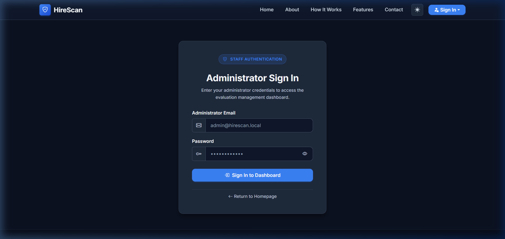

### Key Authentication Features
- **URL Endpoint:** `/admin/login/`
- **Security Protections:** Strict CSRF validation, HTTP-only session cookies, session fixation rotation upon sign-in.
- **Provisioning:** Administrator accounts cannot be created publicly; they must be provisioned via the secure CLI command:
  ```bash
  python manage.py create_admin --email admin@hirescan.io --name "System Admin" --password "YourStrongPassword"
  ```
- **Session Management:** Administrators can securely terminate sessions at any time using the header Sign Out control.

---

## 2. Executive Dashboard & Live Audit Stream

Once authenticated, administrators land on the **Executive Dashboard**, providing an immediate high-level overview of system metrics and a dedicated, independently scrollable audit activity stream.

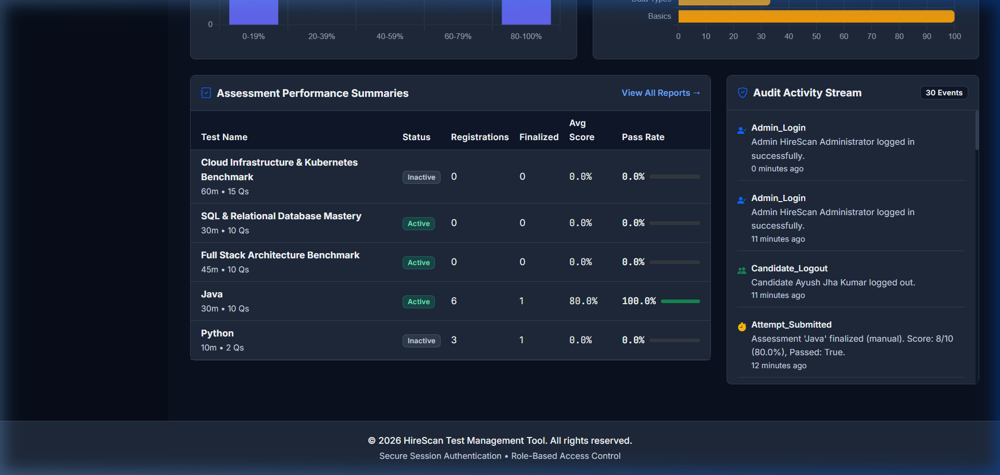

### Dashboard Components
1. **Executive KPI Cards & Pass Rates:**
   - **Overall Pass Rate:** Real-time percentage of finalized examinees who achieved minimum passing scores.
   - **Average Score & Raw Marks:** Authoritative cohort average percentage and mean points.
   - **Finalized Attempts:** Total submissions (manual and auto-finalized timeouts).
   - **Funnel Completion:** Percentage of assigned candidate registrations that reached finalization.
2. **Operational Status Indicators:**
   - **Upcoming Assessments:** Count of active assessments scheduled for future windows, linking directly to `/admin/tests/?status=upcoming`.
   - **In-Progress Assessments:** Count of assessments currently within their open window, linking to `/admin/tests/?status=in_progress`.
   - **Recently Completed Assessments:** Count of closed assessments, linking to `/admin/tests/?status=completed`.
   - **Registrations Awaiting Completion:** Count of candidates registered who have not yet started their attempt, linking to `/admin/registrations/`.
   - **Failed Notification Deliveries:** Prominent warning banner and status indicator alerting administrators when email dispatches encounter SMTP or network failures, linking directly to `/admin/registrations/notifications/?status=failed`.
3. **Independent Audit Activity Stream:**
   - Positioned on the right panel, this container has a fixed height with an independent vertical scrollbar.
   - Captures real-time actions: Candidate imports, test status toggles, registration updates, notification dispatches, retries, and unauthorized access attempts.
   - Avoids page-lengthening sprawl and lets administrators audit historical activities without scrolling away from primary metrics.
4. **Quick Navigation Shortcuts:** One-click links to create new tests, import candidates, register examinees, or download performance reports.

---

## 3. Candidate Roster & Bulk CSV Import

### 3.1 Candidate Directory
The Candidate Directory (`/admin/candidates/`) lists all candidates imported into the system.

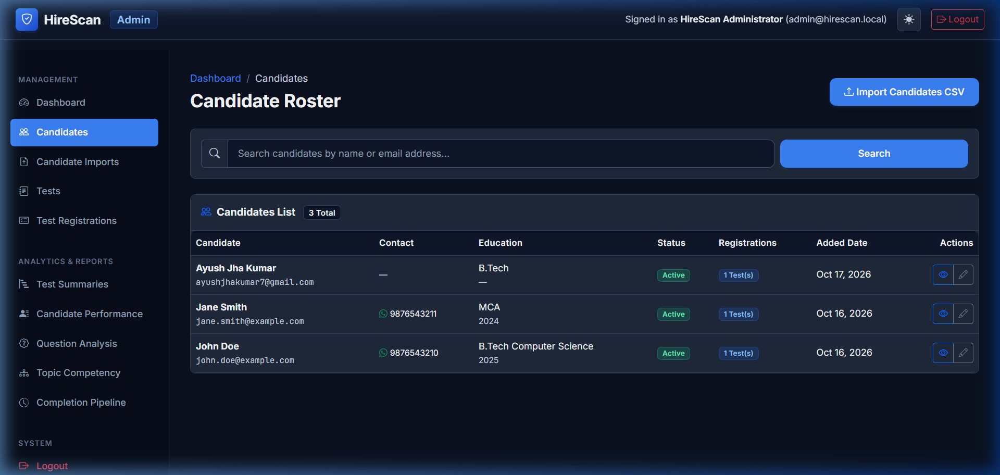

- **Multi-Field Server-Side Search:** Search candidates instantly across name, email, WhatsApp number, and college/institution address.
- **Status Filter:** Filter candidate records by **All Statuses**, **Active**, or **Inactive**.
- **Pagination State Preservation:** Searching and filtering parameters are preserved across pagination links via URL query string encoding (`?q=...&status=...&page=2`).
- **Status Controls:** Toggle candidate status between **Active** and **Inactive** with a single click. Inactive candidates cannot request OTPs or start assessments.
- **Candidate Details:** View assigned tests, historical attempts, and contact information.

### 3.2 Bulk CSV Import Wizard
Administrators can onboard dozens or hundreds of candidates simultaneously via the CSV Import Wizard (`/admin/candidates/import/`).

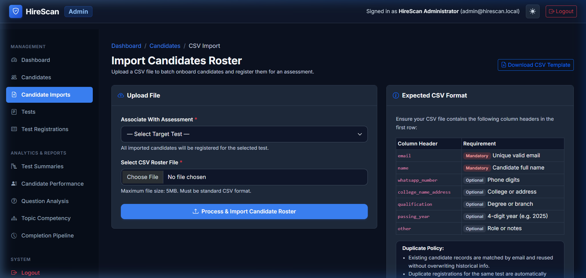

#### CSV Format Specification
| Column Header | Requirement | Format / Validation | Description |
| :--- | :--- | :--- | :--- |
| `name` | Required | Plain text (1-200 chars) | Full legal name of the candidate |
| `email` | Required | Valid RFC email | Unique email address used for OTP authentication |
| `phone` | Optional | E.164 or digits (e.g., +1234567890) | Contact telephone number |
| `college` | Optional | Plain text (1-200 chars) | University, institution, or organization |

#### Import Processing & Validation Rules
- **Atomic Processing:** The entire file is validated row-by-row before database commitment.
- **Deduplication:** Existing candidates with matching emails can be either updated or skipped according to import options.
- **Error Recovery:** If any row fails validation (e.g., malformed email or missing name), a detailed error report CSV is immediately downloadable, detailing the exact row number and failure cause.

---

## 4. Assessment Management & Test Creation

### 4.1 Assessment Roster & Lifecycle Tracking
The Tests Roster (`/admin/tests/`) displays all configured technical assessments with real-time lifecycle tracking across five distinct statuses.

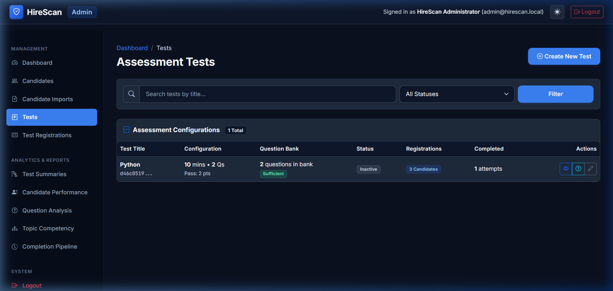

#### 5-Status Test Lifecycle
| Status | Visual Badge | Business Rule & Transition Conditions |
| :--- | :--- | :--- |
| **Cancelled** | Red (`bg-danger-subtle text-danger`) | Test has been explicitly cancelled by an administrator; all access is immediately revoked. |
| **Completed** | Blue (`bg-primary-subtle text-primary`) | The scheduled test window (`end_time`) has elapsed, or all registered candidates have completed their attempts. |
| **In Progress** | Green (`bg-success-subtle text-success`) | The test is active and within its permitted time window (`start_time <= now <= end_time`). |
| **Upcoming** | Cyan (`bg-info-subtle text-info`) | The test is published/active, but the scheduled start time is in the future (`now < start_time`). |
| **Scheduled** | Grey (`bg-secondary-subtle text-secondary`) | The test is currently in draft/inactive state (`is_active=False`) awaiting publication or start. |

- **Server-Side Status Filtering:** Filter tests by lifecycle status or publication state with instant query parameter preservation.
- **Question Sufficiency Rule:** Tests **cannot be activated** unless the question bank contains at least `total_questions`. If an administrator attempts to activate an under-resourced test, the system prevents activation and alerts the user.
- **Actions:** Quick links to manage questions, inspect candidate attempts, view test details, edit parameters, or toggle publication.

### 4.2 Test Creation Wizard
Creating a new assessment (`/admin/tests/create/`) involves defining testing parameters and optional schedule windows:

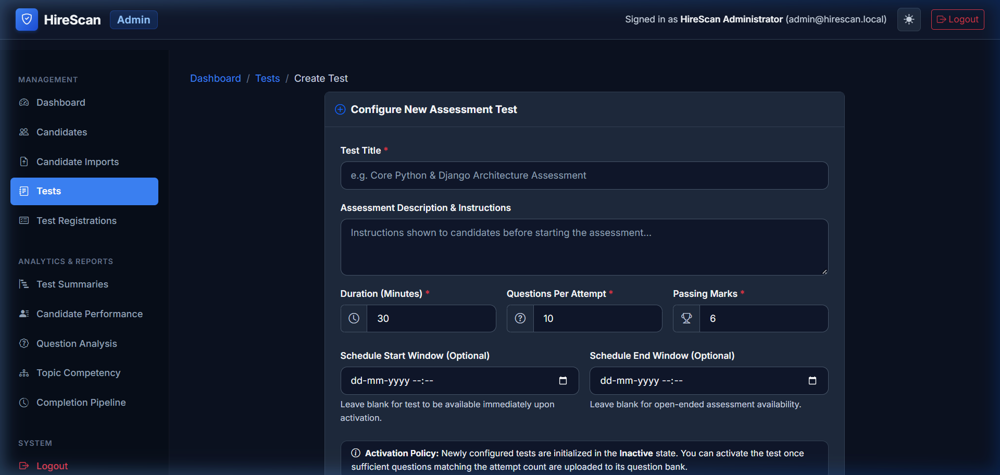

- **Test Name & Description:** Descriptive title and instructions displayed to candidates prior to launching.
- **Duration (Minutes):** Enforced assessment countdown timer.
- **Total Questions:** Number of questions randomly assigned to each candidate from the question bank.
- **Passing Marks:** Minimum score required to achieve a passing grade.
- **Scheduled Start & End Time (Optional):** Define the precise examination window using localized datetime pickers.
- **Initial Status:** Defaulted to Inactive until questions are populated.

### 4.3 Test Detail & Cancellation Control
Administrators can inspect test configurations and toggle cancellation with a single click (`/admin/tests/<test_id>/`):

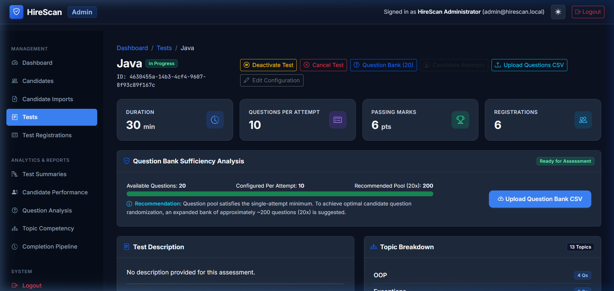

- **Cancellation Toggle:** Cancel active examinations during emergencies or reschedule cancelled tests.
- **Schedule Window Inspection:** Displays scheduled start and end times in the configured timezone.
- **Question Bank Sufficiency Breakdown:** Visual indicator of question availability against requirements.

---

## 5. Question Bank Management & Bulk Import

### 5.1 Question Bank
Each test possesses its own dedicated Question Bank (`/admin/tests/<test_id>/questions/`).

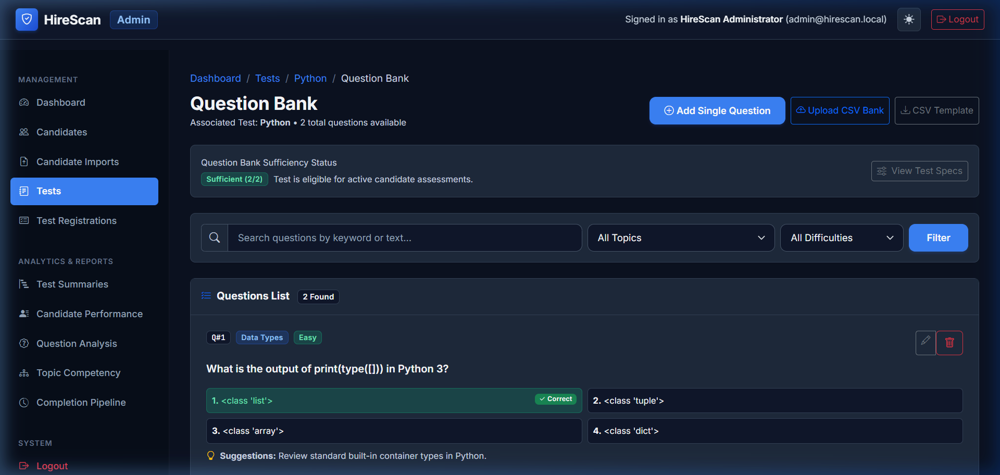

- **Question Details:** Supports 4-option multiple choice questions (MCQ).
- **Topic Categorization:** Assign questions to specific skills or domains (e.g., Python, SQL, Architecture, Algorithms).
- **Difficulty Grading:** Mark questions as Easy, Medium, or Hard for balanced candidate evaluations.
- **Improvement Suggestions:** Feedback hints linked to specific questions that automatically populate candidate scorecards if the question is missed.

### 5.2 Bulk Question CSV Import
Administrators can rapidly populate question banks using the Question CSV Import tool (`/admin/tests/<test_id>/questions/import/`).

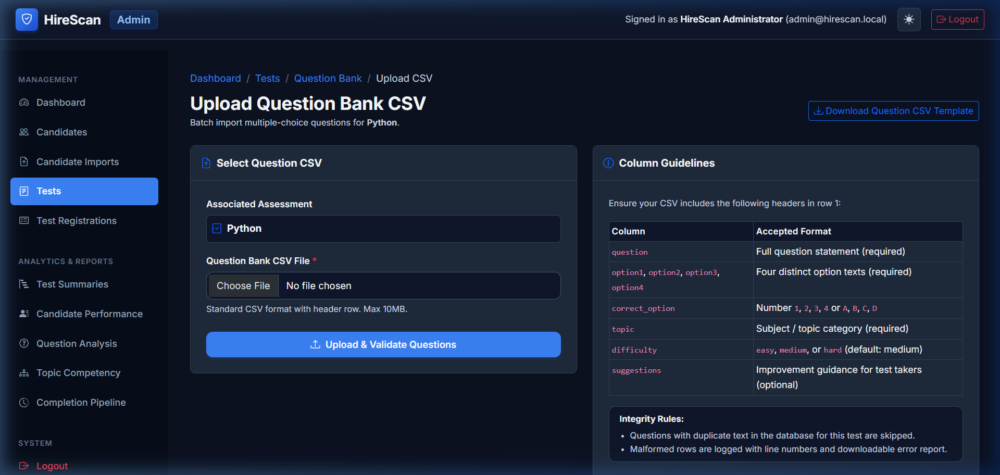

- **Template Download:** Pre-formatted CSV template available with a single click.
- **Columns:** `question_text`, `option1`, `option2`, `option3`, `option4`, `correct_option` (1-4), `topic`, `difficulty`, `suggestions`.
- **Integrity Guarantee:** Correct options are validated to ensure they map to numbers 1 through 4.

---

## 6. Candidate Registrations & Scheduling

The Registrations module (`/admin/registrations/`) bridges candidates and active assessments, supporting both individual assignments and high-capacity bulk registrations.

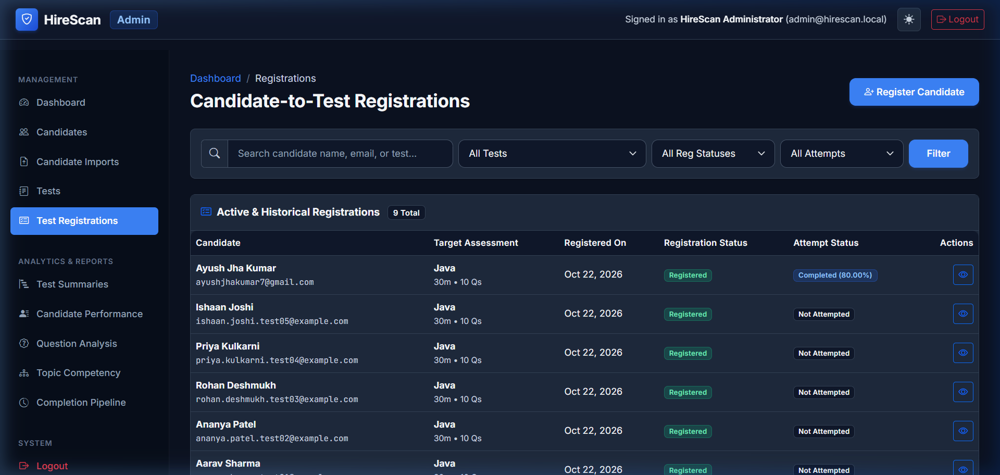

### 6.1 Multi-Parameter Search & Filtering
- **Multi-Field Search:** Locate registrations by candidate name, candidate email, or test title.
- **Filter by Test:** Narrow down registrations to a specific assessment.
- **Filter by Registration Status:** Filter by `Registered` or `Cancelled`.
- **Filter by Attempt Status:** Filter by `Not Started`, `In Progress`, `Completed`, or `Expired`.
- **Pagination Preservation:** All active filters and search terms are maintained across pages.

### 6.2 High-Capacity Bulk Candidate Registration
Administrators can assign entire cohorts of candidates to an assessment in a single operation (`/admin/registrations/create/`):

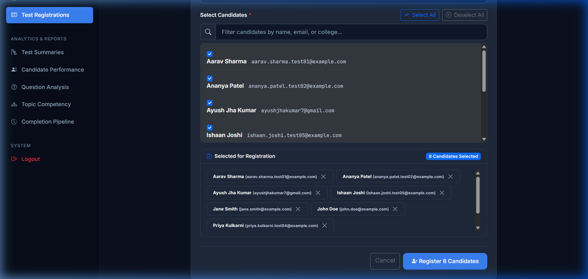

#### Key Bulk Registration Features
1. **Dual-Mode Interface:** Switch between **Single Candidate** and **Multiple Candidates (Bulk)** tabs.
2. **Live Search Filter:** Rapidly filter candidate checkboxes in real time by name, email, or college.
3. **Select All & Deselect All:** One-click bulk selection controls.
4. **Selected Candidate Review Tray:** Displays candidate chips with dismissible `×` buttons so administrators can review and prune selections prior to submission.
5. **Dynamic Count Badge:** Real-time counter showing the exact number of candidates selected for registration.
6. **Atomic Transaction Commitment:** All candidate assignments are committed within `transaction.atomic()`, preventing partial batch creation upon unexpected database conflicts.
7. **Transparent Status Reporting:**
   - **Created:** Reports total registrations successfully added.
   - **Already Registered:** Identifies candidates who were already registered for the test.
   - **Rejected:** Reports inactive or ineligible candidate selections with clear explanations.

### 6.3 Notification Delivery Monitoring & Safe Retries
The Notification Delivery Monitor (`/admin/registrations/notifications/`) logs every candidate email dispatch:
- **Delivery Status Tracking:** Distinct visual badges for **Sent** (green) and **Failed** (red) email attempts.
- **Credential & Secret Redaction:** Failure error messages sanitize SMTP passwords or authorization tokens to ensure sensitive infrastructure credentials are never exposed in administrative logs or UI tables.
- **Controlled, Idempotent Retries:** For failed dispatches, administrators can trigger a secure, CSRF-protected retry (`POST /admin/registrations/notifications/<log_id>/retry/`).
- **Deduplication Safeguard:** Before sending, the engine verifies that no subsequent notification of the same type has succeeded for this candidate and test, preventing duplicate emails.
- **Registration Isolation:** Network or SMTP delivery failures never crash or corrupt underlying assessment registrations.

---

## 7. Granular Attempt Review & Scorecards

When a candidate completes an assessment, administrators can inspect the full submission record (`/admin/tests/attempts/<attempt_id>/`).

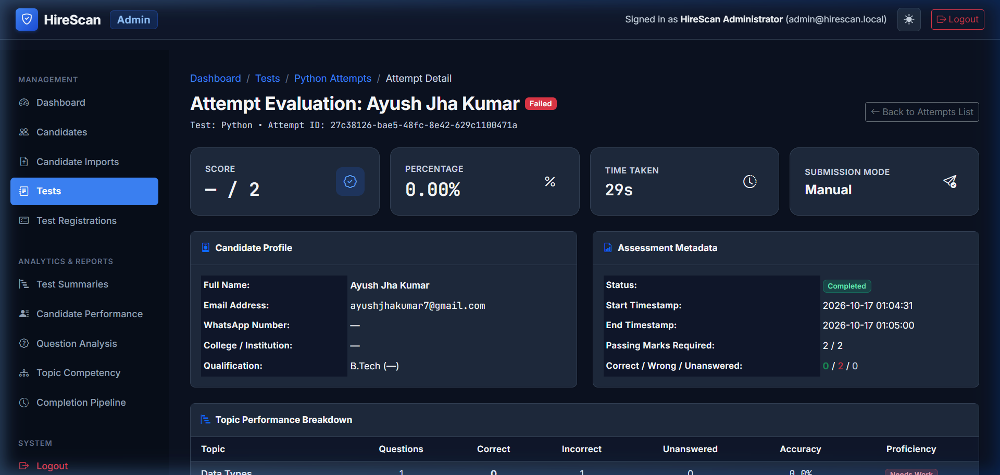

### Attempt Review Details
- **Candidate Metadata:** Name, email, registration timestamp, start and completion timestamps.
- **Performance Summary:** Total score, percentage, passing status, and duration taken.
- **Question-by-Question Audit:**
  - Question text, assigned topic, and difficulty level.
  - Selected option vs. correct option.
  - Autosave timestamps and response latency.
- **PDF Scorecard Export:** Generate and download an executive, branded PDF scorecard directly from the portal.

---

## 8. Executive Analytics & Reporting Suite

The HireScan Analytics Suite delivers data-driven hiring insights across five dedicated reporting modules.

### 8.1 Test Summary Benchmarks
Navigate to `/admin/analytics/tests/` for cohort-level metrics across all tests.

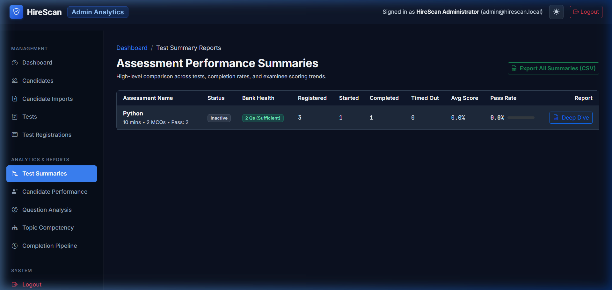

- **Metrics Displayed:** Total registrations, completed attempts, pass rate percentage, average score, median score, and standard deviation.
- **Cohort Comparisons:** Compare performance across different examination batches.

### 8.2 Candidate Performance Directory
Navigate to `/admin/analytics/candidates/` for examinee rankings.

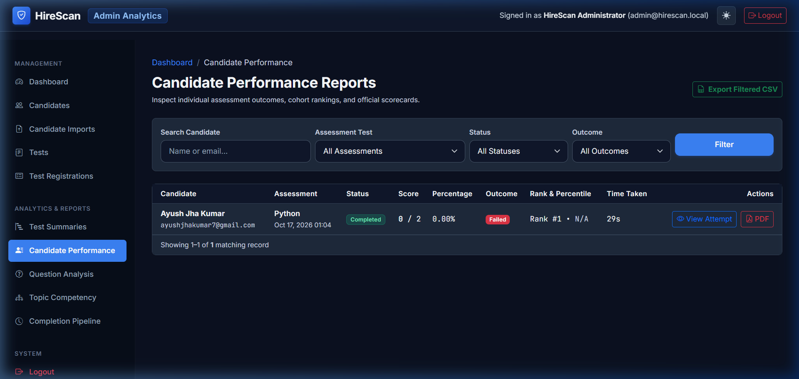

- **Detailed Candidate Ranks:** Sortable by score, percentage, completion speed, and submission timestamp.
- **Filter by Test:** Filter rankings by specific technical assessment.

### 8.3 Question Item & Difficulty Analysis
Navigate to `/admin/analytics/questions/` for item-response psychometric evaluation.

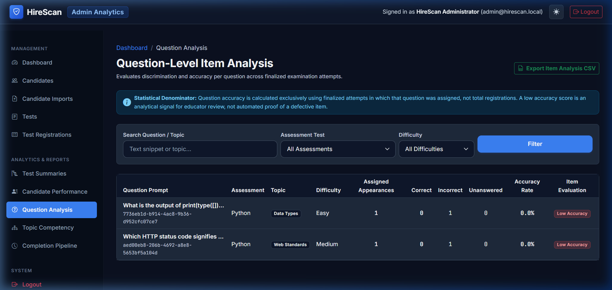

- **Accuracy Rate (%):** Percentage of candidates who answered each question correctly.
- **Difficulty Classification:** Flags questions that are statistically too easy (>90% accuracy) or excessively difficult (<20% accuracy).
- **Discrimination Index:** Identifies whether top-performing candidates answered correctly compared to lower-performing candidates.

### 8.4 Topic Competency Breakdown
Navigate to `/admin/analytics/topics/` to identify skill gaps.

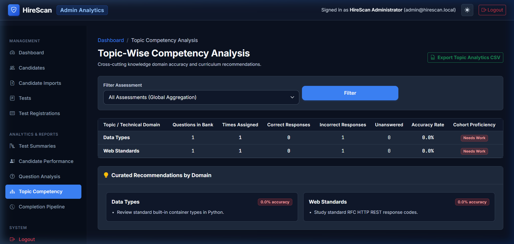

- **Topic Radar & Bar Breakdown:** Performance categorized by technical subject (e.g., Django, Python Core, Algorithms, SQL).
- **Curriculum & Hiring Insights:** Pinpoint specific domain strengths and weaknesses across candidate pools.

### 8.5 Candidate Funnel & Completion Pipeline
Navigate to `/admin/analytics/completion/` for recruitment pipeline velocity.

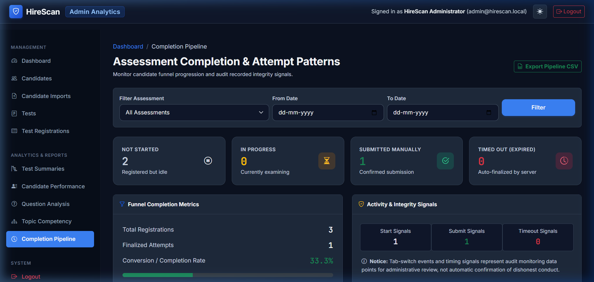

- **Funnel Stages:** Registered $\rightarrow$ Assessment Launched $\rightarrow$ Questions Autosaved $\rightarrow$ Finalized Submission.
- **Drop-off Analysis:** Detect candidate abandonment rates or technical timeouts.

---

---

## 9. Mentor-Approved Platform Enhancements

HireScan incorporates six production enhancements to expand institutional governance, psychometric analytics, and operational automation:

### 9.1 Automated Email Notifications & Examination Reminders
- **Transactional Triggers:** Registered examinees automatically receive branded HTML emails with plain-text fallback upon enrollment, test activation, and schedule cancellations.
- **Automated Deadline Reminders:** Background cron/scheduled execution via Django management command:
  ```bash
  python manage.py send_assessment_reminders --hours=24
  ```
  Scans all upcoming active tests within the time window and dispatches non-duplicate reminders.
- **Anti-Duplicate Mechanism:** Backed by database-level `NotificationLog` records preventing duplicate emails on repeated runs.
- **Dedicated Delivery Monitor (`/admin/registrations/notifications/`):** Centralized administration console to inspect all outgoing candidate emails, filter by status (`Sent` vs `Failed`), filter by type (`registered`, `available`, `reminder`, `schedule_updated`, `cancelled`), and execute safe retries for failed dispatches with credential redaction.

### 9.2 Bulk Registration Summary
- **Detailed Outcomes Screen:** Post-registration summary screen displaying overall metrics (Total Selected, Registrations Created, Already Registered, Rejected/Invalid).
- **Candidate Breakdown Tables:** Displays candidate names, emails, and exact rejection/conflict reasons without leaving partial or corrupted records.

### 9.3 Comprehensive Audit Logging & Categorization
- **Full Operational Coverage:** Captures question authoring (`question_created`, `question_updated`, `question_deleted`), CSV and PDF exports (`report_exported_csv`, `report_exported_pdf`), examinee lifecycle events, and unauthorized access attempts (`unauthorized_access_attempt`).
- **Activity Stream Dashboard:** Categorized badges (Security, Examination, Authoring, Reporting) with actor attribution (Admin, Candidate, System) in a responsive, independently scrollable container.

### 9.4 Advanced Assessment Psychometrics & Cross-Assessment Analytics
- **Statistical Spread:** Median score, score range, and standard deviation calculations across finalized examinee attempts.
- **Score Distribution Breakdown:** Quadrant buckets (Excellent 90–100%, Proficient 75–89%, Average 50–74%, Below Standard <50%).
- **Item Psychometrics:**
  - **Facility Index ($P$):** Proportion of candidates answering correctly ($0.00$ to $1.00$).
  - **Discrimination Index ($D$):** Upper 27% vs. lower 27% comparison formula for cohorts $\ge 4$, flagging balanced, high-accuracy, and review items.
- **Candidate Competency Profiles:** Cross-assessment score history, multi-test timelines, and demonstrated topic strengths ($\ge 75\%$) vs. focus areas ($< 50\%$) on candidate detail pages.

### 9.5 Assessment Integrity & Tamper-Evident Defenses
- **Server-Side Timestamp Enforcement:** Clock timing, autosave validations, and manual submissions verified against authoritative server clocks.
- **Mid-Flight Cancellation Guard:** Revoked or cancelled assessments immediately disallow subsequent answer autosaves or submissions.
- **Authorization & IDOR Protection:** Candidate attempts, scorecards, and administrative exports enforce strict session verification and log unauthorized probes.

### 9.6 Automated Executive Report Generation
- **Assessment Summary PDF:** Formatted ReportLab PDF containing institutional KPI headers, statistical distributions, score brackets, topic breakdowns, and the mandatory two-line security footer.
- **Filtered Candidate Results PDF:** Export current candidate search and filter selections to an executive PDF report.

### 9.7 Spreadsheet Formula Injection Defense & Error CSV Exports
- **Formula Injection Defense:** All generated CSV reports and downloadable error files sanitize every cell via `sanitize_csv_cell()` to prevent CSV formula injection (`=`, `+`, `-`, `@`, `\t`, `\r`).
- **Downloadable Error CSVs:** During bulk candidate or question bank imports, validation failures can be immediately downloaded as dedicated CSV files (`candidate_import_errors.csv` and `question_import_errors.csv`) with row numbers and exact rejection reasons.

---

## Summary of Administrator URLs

| Module | URL | Description |
| :--- | :--- | :--- |
| **Login** | `/admin/login/` | Secure administrator authentication |
| **Dashboard** | `/dashboard/` | KPI cards and live audit activity stream |
| **Candidates** | `/admin/candidates/` | Candidate directory and cross-assessment profile |
| **Candidate Import** | `/admin/candidates/import/` | CSV batch candidate onboarding |
| **Tests** | `/admin/tests/` | Assessment configurations and question banks |
| **Test Create** | `/admin/tests/create/` | New assessment creation wizard |
| **Registrations** | `/admin/registrations/` | Assessment scheduling and enrollment |
| **Bulk Summary** | `/admin/registrations/bulk-summary/` | Post-registration breakdown and conflict report |
| **Test Summaries** | `/dashboard/tests/` | Cohort benchmarks, median, and distributions |
| **Test Summary PDF** | `/dashboard/export/tests/<uuid>/pdf/` | Downloadable executive assessment PDF summary |
| **Candidate Analytics** | `/dashboard/candidates/` | Candidate scoring leaderboards and percentiles |
| **Candidate Results PDF** | `/dashboard/export/candidates/pdf/` | Filtered candidate performance PDF export |
| **Question Analytics** | `/dashboard/questions/` | Item facility and discrimination index psychometrics |
| **Topic Analytics** | `/dashboard/topics/` | Domain and skill competency breakdown |
| **Completion Pipeline** | `/dashboard/completion/` | Candidate progression and drop-off funnel |
| **Notifications Monitor**| `/admin/registrations/notifications/` | Candidate email delivery monitor & safe retry console |
| **Candidate Errors CSV**| `/admin/candidates/import/errors/csv/` | Downloadable sanitized candidate import error CSV |
| **Question Errors CSV** | `/admin/assessments/questions/import/errors/csv/` | Downloadable sanitized question import error CSV |

