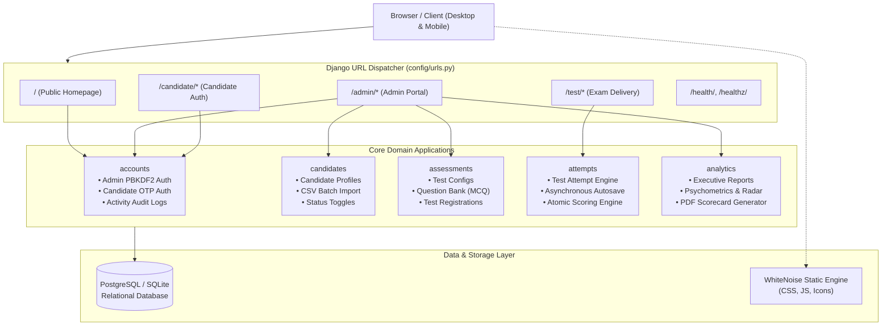
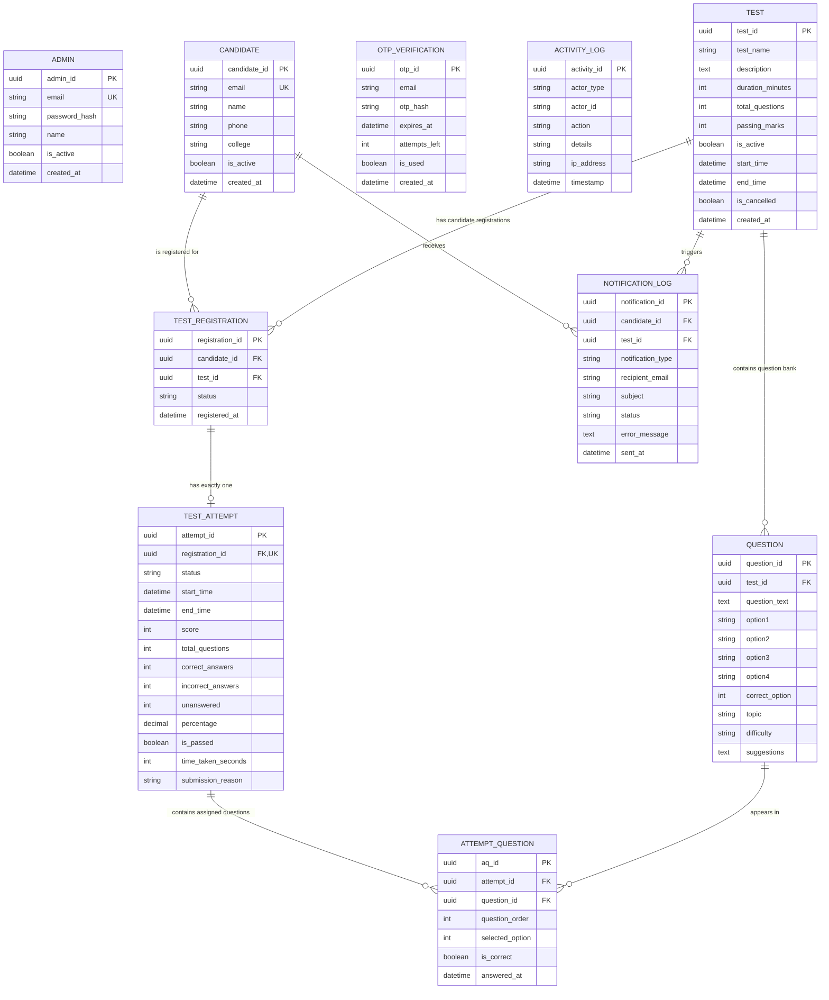
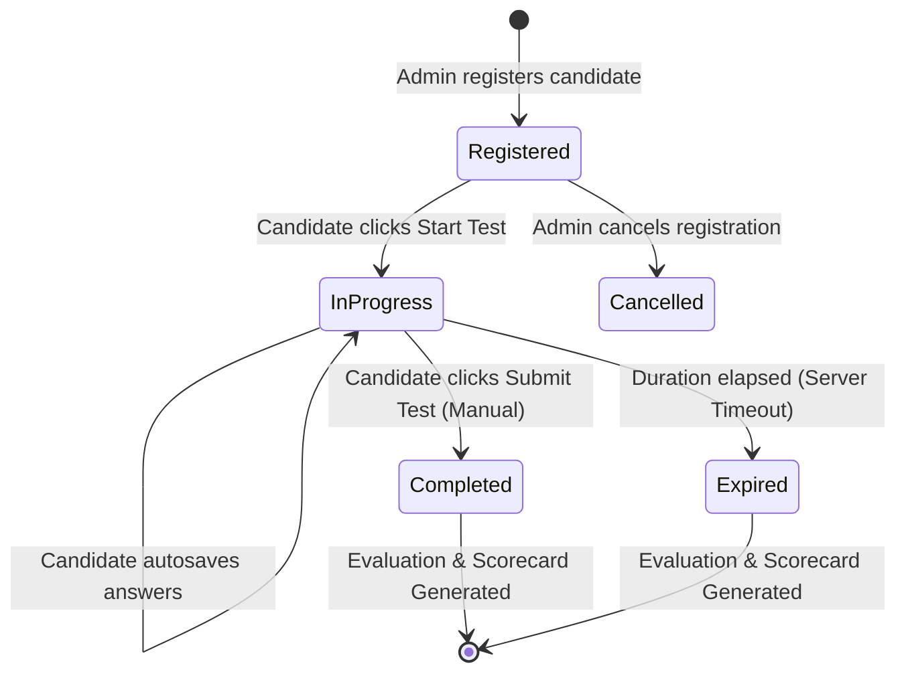
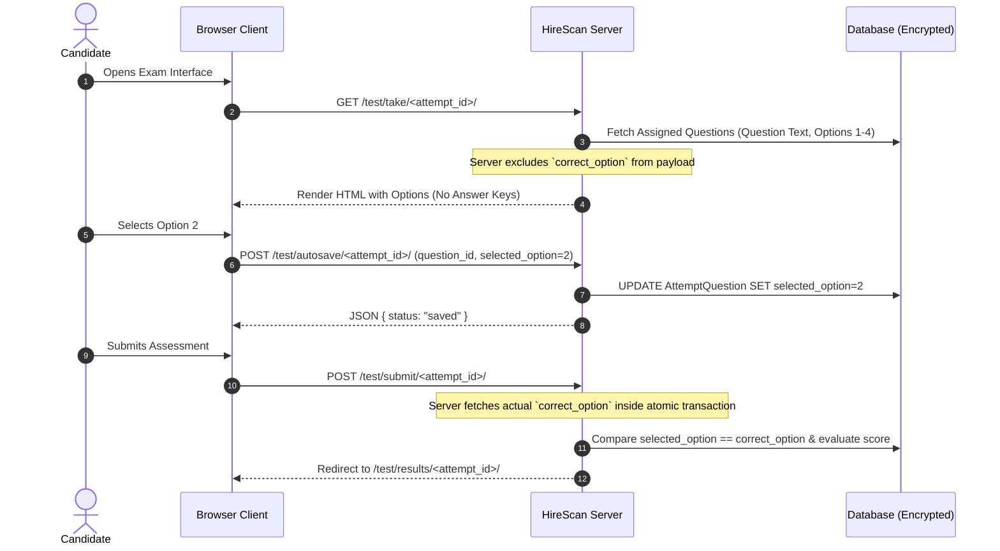

# HireScan — System Architecture & Technical Specifications

This document defines the high-level system architecture, data models, transactional boundaries, and security patterns implemented in **HireScan — Test Management Tool**.

---

## Table of Contents
1. [Architectural Principles](#1-architectural-principles)
2. [Component Architecture & Separation of Concerns](#2-component-architecture--separation-of-concerns)
3. [Entity Relationship (ER) Specifications](#3-entity-relationship-er-specifications)
4. [Mermaid Entity Relationship Diagram](#4-mermaid-entity-relationship-diagram)
5. [Candidate Assessment State Machine](#5-candidate-assessment-state-machine)
6. [Concurrency, Locking & Transactional Integrity](#6-concurrency-locking--transactional-integrity)
7. [Zero-Answer-Leak Information Flow](#7-zero-answer-leak-information-flow)
8. [Database Indexing Strategy](#8-database-indexing-strategy)

---

## 1. Architectural Principles

HireScan adheres to the following architectural tenets:

- **No Django Admin:** Avoids generic boilerplate admin screens; all administrative features are custom-built with targeted business logic, responsive UI, and granular auditing.
- **Explicit Form & View Validation:** Pure Django views handle custom validation without coupling business logic to standard `ModelForms`, ensuring precise control over error reporting and response formatting.
- **Zero-Answer-Leak Security:** The server separates question metadata from correct answer keys. Client browsers never receive correct answer options during exam delivery.
- **Cryptographic Hashing for Passwords & OTPs:** All sensitive authentication tokens are hashed using PBKDF2 with SHA-256 before persistence.
- **Fail-Safe Server-Side Time Enforcement:** Timer evaluation and test finalization occur on the server. Client-side clocks are purely visual aids.
- **Modular Django Applications:** Each domain is isolated within its own app, maintaining clean interfaces and decoupled service layers.

---

## 2. Component Architecture & Separation of Concerns

The codebase is organized into six focused Django applications:



### Module Responsibilities

| Application | Purpose | Key Responsibilities |
| :--- | :--- | :--- |
| `accounts` | Identity & Access Management | Admin password auth, Candidate OTP generation/validation, PBKDF2 hashing, session control, activity logging. |
| `candidates` | Candidate Management | Candidate profile directory, CSV roster bulk imports, search, status toggles (`is_active`). |
| `assessments` | Assessment Configuration | Test authoring, Question Bank CRUD, question CSV import, question sufficiency verification, test registration, notification delivery monitoring & safe retries. |
| `attempts` | Examination Delivery | Candidate test session, question assignment, asynchronous autosave, server-side timer enforcement, atomic evaluation. |
| `analytics` | Business Intelligence | Test summaries, candidate leaderboards, question discrimination analysis, topic radar charts, PDF generation. |
| `config` | Application Root | Django settings, middleware pipeline, URL routing, custom error handlers (400, 403, 404, 500), health checks. |

---

## 3. Entity Relationship (ER) Specifications

All database tables utilize cryptographically secure, collision-resistant UUID4 primary keys to prevent enumeration attacks and support distributed scalability.

### Database Tables Summary

| Table Name | Model Class | Primary Key | Description |
| :--- | :--- | :--- | :--- |
| `admin_user` | `accounts.Admin` | `admin_id` (UUID) | System administrator accounts with unique email and hashed password. |
| `candidate` | `accounts.Candidate` | `candidate_id` (UUID) | Examinee records created via admin CSV import with unique email and `is_active` flag. |
| `otp_verification` | `accounts.OTPVerification` | `otp_id` (UUID) | 6-digit candidate OTP records with PBKDF2 hash, 5-min TTL, and 3-attempt limit. |
| `activity_log` | `accounts.ActivityLog` | `activity_id` (UUID) | Immutable audit log of administrative actions, imports, and logins. |
| `test` | `assessments.Test` | `test_id` (UUID) | Test configurations with duration, total questions, passing marks, `start_time`, `end_time`, `is_cancelled`, and `is_active` flag. |
| `question` | `assessments.Question` | `question_id` (UUID) | 4-option MCQs belonging to a test bank with topic, difficulty, suggestions, and correct option. |
| `test_registration`| `assessments.TestRegistration` | `registration_id` (UUID) | Bridge table connecting candidate to test. Enforces `UNIQUE(candidate, test)`. |
| `test_attempt` | `attempts.TestAttempt` | `attempt_id` (UUID) | Single attempt per registration via `OneToOneField`. Tracks score, time, status, and reason. |
| `attempt_question` | `attempts.AttemptQuestion` | `aq_id` (UUID) | Individual questions assigned to an attempt. Enforces `UNIQUE(attempt, question)`. |
| `notification_log` | `assessments.NotificationLog` | `notification_id` (UUID) | Audit log of candidate email notifications (registered, available, reminder, cancelled, schedule_updated). |

---

## 4. Mermaid Entity Relationship Diagram



---

## 5. Candidate Assessment State Machine

Each candidate assessment follows a strict, irreversible state machine:



### State Transitions
1. **`Registered`:** Candidate is eligible to launch the test. Test must be active and have sufficient questions.
2. **`InProgress`:** Timer is initialized (`start_time = now()`). Assigned questions are selected and locked.
3. **`Completed`:** Triggered by explicit user submission before timeout. Responses are evaluated and results saved atomically.
4. **`Expired`:** Triggered if elapsed wall-clock time exceeds `duration_minutes`. The system evaluates all autosaved responses up to the expiry point.

---

## 6. Concurrency, Locking & Transactional Integrity

To prevent race conditions, double submissions, or duplicate registrations, HireScan enforces strict database-level concurrency controls:

1. **Atomic Assessment Evaluation:**
   ```python
   with transaction.atomic():
       attempt = TestAttempt.objects.select_for_update().get(pk=attempt_id)
       if attempt.status != 'in_progress':
           return attempt  # Prevent double evaluation
       
       # Score calculation and state transition
       ...
       attempt.status = 'completed'
       attempt.save()
   ```
2. **Unique Constraints:**
   - `UNIQUE(candidate_id, test_id)` on `TestRegistration` prevents accidental duplicate enrollments.
   - `OneToOneField(TestRegistration)` on `TestAttempt` guarantees at most one attempt per candidate registration.
   - `UNIQUE(attempt_id, question_id)` on `AttemptQuestion` ensures no question is assigned twice in the same attempt.

---

## 7. Zero-Answer-Leak Information Flow

HireScan prevents examinees from extracting answer keys through browser developer tools:



---

## 8. Database Indexing Strategy

To guarantee sub-second dashboard and reporting query latency across tens of thousands of attempts, the following database indexes are applied:

- **`idx_candidate_email`:** Fast lookups during candidate OTP verification.
- **`idx_test_active`:** Filtering published vs. inactive tests.
- **`idx_registration_unique`:** Compound index on `(candidate_id, test_id)`.
- **`idx_attempt_status`:** Aggregations for `in_progress`, `completed`, and `expired` attempts.
- **`idx_aq_attempt_question`:** Fast retrieval of question states during exam autosaves.
- **`idx_activity_timestamp`:** Sorting and slicing the live executive audit stream.
- **`idx_notif_cand_test_type`:** Compound index on `(candidate, test, notification_type)` enforcing fast notification deduplication.
- **`idx_notif_sent_at`:** Chronological sorting for the notification delivery monitor.
- **`idx_notif_status`:** Rapid filtering for failed vs. sent notifications.
