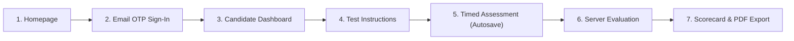
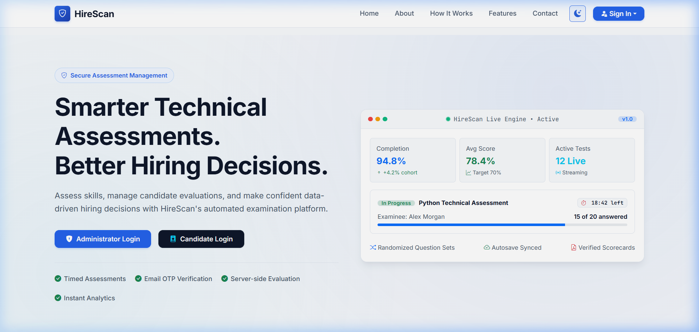
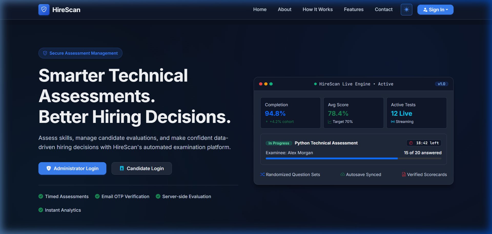
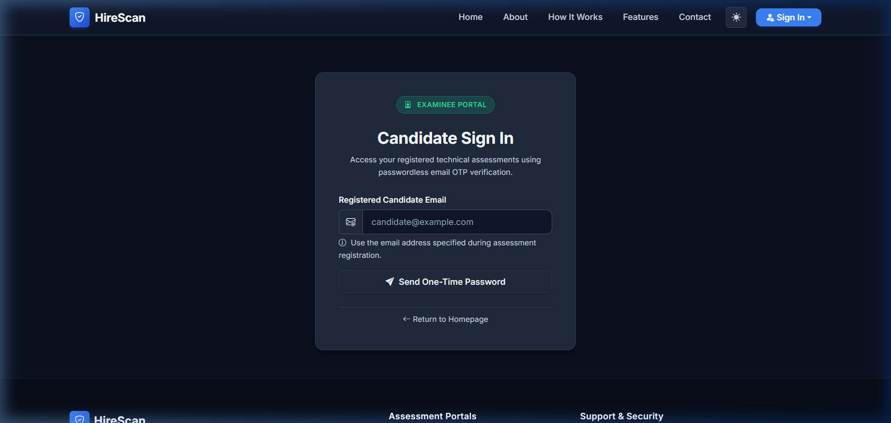

# HireScan — Candidate Assessment & Examination Guide

Welcome to the **HireScan Candidate Assessment Guide**. This document outlines the end-to-end examinee journey, from launching the landing page and verifying your identity with passwordless email OTP authentication to navigating the timed examination interface, autosaving responses, and reviewing your evaluated scorecard.

---

## Table of Contents
1. [Assessment Journey Overview](#1-assessment-journey-overview)
2. [Candidate Portal Access & Dark/Light Mode](#2-candidate-portal-access--darklight-mode)
3. [Passwordless Email OTP Authentication](#3-passwordless-email-otp-authentication)
4. [Candidate Dashboard & Assigned Tests](#4-candidate-dashboard--assigned-tests)
5. [Exam Instructions & Integrity Rules](#5-exam-instructions--integrity-rules)
6. [Interactive Examination Interface](#6-interactive-examination-interface)
   - [6.1 Question Palette & Status Indicators](#61-question-palette--status-indicators)
   - [6.2 Asynchronous Answer Autosave](#62-asynchronous-answer-autosave)
   - [6.3 Countdown Timer & Auto-Finalization](#63-countdown-timer--auto-finalization)
   - [6.4 Anti-Cheating & Integrity Guardrails](#64-anti-cheating--integrity-guardrails)
7. [Submission, Evaluation & Scorecard PDF](#7-submission-evaluation--scorecard-pdf)

---

## 1. Assessment Journey Overview

HireScan provides a seamless, zero-friction testing experience designed to ensure fairness, security, and maximum accessibility:

---

## 2. Candidate Portal Access & Dark/Light Mode

Candidates access HireScan by visiting the public homepage (`/`). The application features an adaptive, high-contrast visual theme system with a centralized Dark/Light mode toggle located in the navigation header.

| Light Mode Interface | Dark Mode Interface |
| :---: | :---: |
|  |  |

- **Header Controls:** Switch effortlessly between light and dark themes based on lighting conditions.
- **Direct Navigation:** Click **"Candidate Sign In"** or **"Take Assessment"** to proceed to the OTP verification page.

---

## 3. Passwordless Email OTP Authentication

To eliminate vulnerable passwords and credential sharing, HireScan utilizes passwordless one-time password (OTP) authentication (`/candidate/login/`).

### Step-by-Step Login Instructions
1. **Enter Registered Email:** Provide the exact email address registered for you by the test administrator.
2. **Request One-Time Password:** Click **"Send Verification Code"**. The system sends a 6-digit numeric OTP to your email inbox.
3. **Enter OTP Code:** Type the 6-digit code received into the verification field and click **"Verify & Continue"**.

### Security & Throttling Guardrails
- **5-Minute Expiry (TTL):** Each OTP expires automatically after 5 minutes.
- **60-Second Cooldown:** A 60-second waiting period prevents rapid resend abuse.
- **Brute-Force Protection:** Maximum of 3 failed attempts per OTP code before it is permanently invalidated.
- **Cryptographic Hashing:** OTPs are never stored in plaintext; they are hashed using PBKDF2 with SHA-256 before database insertion.
- **Anti-Enumeration Protection:** If an unregistered email is entered, the interface returns a neutral message without disclosing account existence.

---

## 4. Candidate Dashboard & Assigned Tests

Upon successful verification, candidates are redirected to their personalized dashboard (`/test/dashboard/`).

### Dashboard Features
- **Candidate Profile:** Displays candidate name, email, and institution.
- **Assigned Assessments Table:** Lists all examinations linked to the candidate:
  - **Test Title & Description:** Subject domain and instructions.
  - **Duration & Total Questions:** Assessment parameters.
  - **Action Button:**
    - **"Start Assessment"**: Available for newly assigned, active examinations.
    - **"Resume Assessment"**: Appears if an in-progress attempt has remaining time.
    - **"View Results"**: Available once the assessment has been submitted and scored.

---

## 5. Exam Instructions & Integrity Rules

Before launching any examination, candidates review the mandatory test instructions screen (`/test/instructions/<registration_id>/`).

### Pre-Exam Checklist
1. **Stable Network:** Ensure a reliable internet connection for smooth autosaving.
2. **Timer Rules:** The assessment duration is strictly enforced server-side. The timer runs continuously once started.
3. **Question Randomization:** Questions are selected and ordered dynamically for each candidate to preserve testing integrity.
4. **Proctoring Rules:**
   - Fullscreen mode is strongly recommended.
   - Tab switching and window minimization are monitored and flagged.
   - Refreshing or closing the browser window does not pause the server countdown timer.

Click **"I Agree & Begin Test"** to initialize the assessment.

---

## 6. Interactive Examination Interface

The HireScan test interface (`/test/take/<attempt_id>/`) is engineered for low latency, high focus, and zero data loss.

### 6.1 Question Palette & Status Indicators
- **Main Question Panel:** Displays the active question prompt, code snippets (with syntax styling), and four clear radio button choices.
- **Navigation Palette:** A grid of question numbers indicating real-time status:
  - 🟢 **Answered:** Response successfully saved to server.
  - ⚪ **Unanswered:** Question not yet attempted.
  - 🟡 **Current:** Question currently active in the viewer.
- **Pagination Controls:** Navigate with **"Previous"**, **"Next"**, or jump directly to any question by clicking its palette badge.

### 6.2 Asynchronous Answer Autosave
- **Instant Persistence:** Whenever you select an answer option, an asynchronous background request (`POST /test/autosave/<attempt_id>/`) persists your choice immediately.
- **Network Resilience:** If network connectivity fluctuates, the interface indicates autosave status and retains your selection locally until reconnected.
- **Review & Change:** You may revisit and change your answers anytime before final submission.

### 6.3 Countdown Timer & Auto-Finalization
- **Live Display:** An intuitive countdown timer stays visible at the top of the interface (`MM:SS`).
- **Visual Alerts:** The timer changes color (from subtle green to warning amber and pulsing red) when less than 5 minutes remain.
- **Server-Side Enforcement:** Even if a candidate disables JavaScript or manipulates the client-side clock, the server evaluates actual elapsed time. When time expires, all saved answers are automatically locked and evaluated.

### 6.4 Anti-Cheating & Integrity Guardrails
- **Zero-Answer-Leak Architecture:** Correct answers are **never** included in client-side HTML, CSS, JavaScript, or JSON payloads. The browser only receives question texts and option labels.
- **Focus Monitoring:** Tab switching triggers warning banners reminding the candidate of active proctoring.

---

## 7. Submission, Evaluation & Scorecard PDF

### 7.1 Finalizing Submission
When you have answered all questions or wish to complete the test:
1. Click the **"Submit Test"** button located on the top-right header or final question screen.
2. A confirmation modal displays the number of answered vs. unanswered questions.
3. Confirm to finalize submission. Once confirmed, answers can no longer be modified.

### 7.2 Instant Server-Side Evaluation
Submissions are evaluated immediately by the server:
- Each selected option is compared against the secure server-side answer key in an atomic database transaction.
- Total score, percentage, and pass/fail thresholds are computed instantly.
- Topic-level competency scores are aggregated.

### 7.3 Results Screen & PDF Scorecard
Candidates are redirected to their comprehensive results overview (`/test/results/<attempt_id>/`):

- **Executive Scorecard:** Displays total score, accuracy percentage, and official **PASSED / FAILED** determination.
- **Topic-Level Breakdown:** Visual bars showing your performance across each domain (e.g., Python, SQL, Architecture).
- **Personalized Improvement Suggestions:** Context-aware recommendations generated from questions you missed.
- **Download Scorecard PDF:** Click **"Download PDF Report"** to receive an official, timestamped PDF credential for your records.
