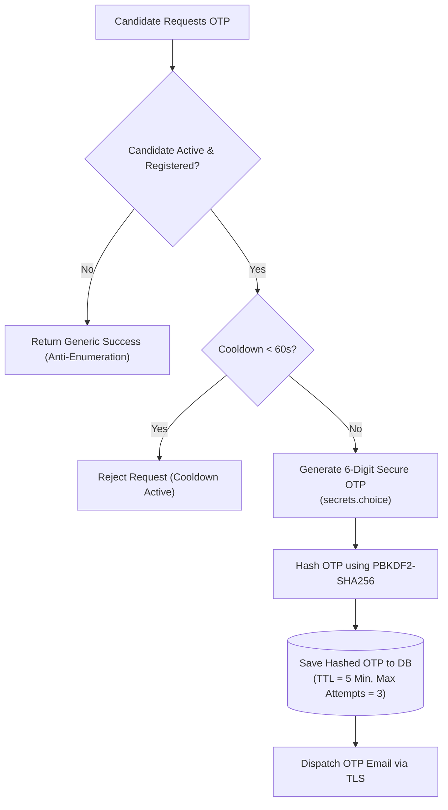

# HireScan — Security Architecture & Threat Model

HireScan is engineered with defensive programming principles and enterprise-grade security controls to safeguard candidate data, prevent examination cheating, protect against credential harvesting, and ensure auditability.

---

## Table of Contents
1. [Security Principles & Threat Model](#1-security-principles--threat-model)
2. [Candidate OTP Authentication Security](#2-candidate-otp-authentication-security)
3. [Examination Access Gating & Schedule Integrity](#3-examination-access-gating--schedule-integrity)
4. [Administrator Authentication Security](#4-administrator-authentication-security)
5. [Zero-Answer-Leak Architecture](#5-zero-answer-leak-architecture)
6. [Anti-Enumeration & Privacy Controls](#6-anti-enumeration--privacy-controls)
7. [Session & Cookie Security](#7-session--cookie-security)
8. [HTTP Security Headers & Transport Layer](#8-http-security-headers--transport-layer)
9. [Audit Logging & Forensic Traceability](#9-audit-logging--forensic-traceability)

---

## 1. Security Principles & Threat Model

HireScan addresses several core attack vectors inherent in online examination systems:

| Attack Vector | Threat Description | HireScan Mitigation |
| :--- | :--- | :--- |
| **Answer Extraction** | Inspecting DOM or network packets to reveal correct MCQ answers. | Answer keys (`correct_option`) are strictly isolated on the server and omitted from all candidate payloads. |
| **Credential Stuffing** | Brute-forcing passwords or reusing leaked credentials. | Candidates have no passwords; they authenticate via ephemeral, single-use email OTPs. |
| **OTP Brute-Forcing** | Guessing 6-digit numeric verification codes. | Capped at 3 failed attempts, 5-minute time-to-live (TTL), and PBKDF2 hashing. |
| **Account Enumeration** | Probing login endpoints to harvest registered candidate or admin emails. | Constant-time processing and identical feedback messages regardless of email existence. |
| **Session Hijacking** | Stealing session tokens over insecure networks. | HTTP-only, Secure, SameSite cookies with session key regeneration on login. |
| **Client Clock Tampering**| Manipulating local device clocks to extend exam duration. | Duration and expiry are evaluated exclusively against server-side UTC timestamps. |
| **SQL Injection** | Injecting SQL syntax through search fields or CSV uploads. | 100% parameterized queries via Django ORM; zero raw string SQL concatenation. |

---

## 2. Candidate OTP Authentication Security

Candidate authentication is entirely passwordless, relying on single-use, time-bound one-time passwords sent via secure SMTP.

### Cryptographic Protections & Email Security
1. **Cryptographically Secure PRNG:** Codes are generated using Python's `secrets` module (`secrets.choice('0123456789')`).
2. **PBKDF2 Hashing:** Plaintext OTPs are never stored in the database. Only PBKDF2-SHA256 hashes are persisted. Even in the event of a database compromise, an attacker cannot read valid OTPs.
3. **Constant-Time Comparison:** OTP verification uses Django's `check_password` which utilizes constant-time comparison algorithms to mitigate timing attacks.
4. **Strict Rate Limiting & Expiry:**
   - **5-Minute Expiry:** OTP records automatically expire 300 seconds after creation.
   - **60-Second Cooldown:** Successive OTP requests within 60 seconds are rejected to prevent email bombardment.
   - **3-Attempt Invalidation:** After 3 incorrect submissions, the OTP record is permanently invalidated (`attempts_left = 0`).
5. **Zero Log Exposure:** Verification codes are strictly excluded from all application logs, debug stack traces, and API responses.
6. **Safe SMTP Exception Isolation:** Email delivery failures are caught cleanly, ensuring server exceptions cannot reveal candidate account existence or bypass authentication.
7. **Responsive HTML & Plain-Text Fallback:** Dispatches branded, responsive emails with explicit security notices advising users never to disclose their verification code.

---

## 3. Examination Access Gating & Schedule Integrity

Access to examination instructions and question pools is protected by multi-layer server-side access controls:

- **Schedule Window Enforcement:** Access is strictly bounded by `start_time` and `end_time`. Attempting to access an assessment before `start_time` (Upcoming) or after `end_time` (Expired) is blocked on the server, irrespective of client time settings.
- **Immediate Cancellation Lock:** Tests marked `is_cancelled=True` immediately revoke candidate access to instructions and prevent attempt initialization.
- **Sufficiency Gate:** An active test cannot be started unless the test question bank contains at least `total_questions`.
- **Atomic Bulk Registrations:** Bulk candidate registrations are executed within atomic database transactions, preventing partial assignments and handling race conditions.

## 4. Administrator Authentication Security

System administrators manage assessments, questions, and sensitive evaluation reports. Administrative access is strictly protected:

- **PBKDF2 Password Hashing:** Standard Django password hashing using PBKDF2 with SHA-256 and 600,000 hash iterations.
- **CLI-Only Administrator Creation:** Administrative accounts cannot be registered through public forms. Administrators are provisioned via `python manage.py create_admin`.
- **Role-Based Decorators:** All administrative views are gated by `@admin_required`, which verifies that the current session belongs to an active administrator before executing view code.

---

## 5. Zero-Answer-Leak Architecture

In many poorly designed examination systems, client-side applications load full question objects (including the correct answers) and check answers locally in JavaScript.

**HireScan enforces a strict Zero-Answer-Leak boundary:**
1. **Isolated Serialization:** When a candidate loads `/test/take/<attempt_id>/`, the view serializes only `question_id`, `question_text`, and choices (`option1` through `option4`). The `correct_option` field is omitted at the database query level.
2. **Server-Side Scoring:** When the candidate autosaves an option, only `(attempt_id, question_id, selected_option)` is recorded.
3. **Atomic Evaluation:** Scoring occurs inside a server-side transaction (`evaluate_attempt`). The database compares `selected_option` against `correct_option` behind the firewall.

---

## 6. Anti-Enumeration & Privacy Controls

To prevent malicious actors from harvesting candidate lists or discovering which candidates are registered for an examination:

- **Neutral Feedback:** Requesting an OTP for an email address that does not exist or is inactive returns the exact same success response: *"If your email is registered, a verification code has been dispatched."*
- **No Error Divergence:** Server response time is padded to ensure no timing differences between existent and non-existent accounts.

---

## 7. Session & Cookie Security

| Setting | Configuration Value | Security Purpose |
| :--- | :--- | :--- |
| `SESSION_COOKIE_HTTPONLY` | `True` | Prevents client-side scripts from reading session cookies, thwarting XSS session theft. |
| `SESSION_COOKIE_SECURE` | `True` (Production) | Enforces transmission of cookies exclusively over HTTPS connections. |
| `SESSION_COOKIE_SAMESITE` | `'Lax'` | Defends against Cross-Site Request Forgery (CSRF) across third-party websites. |
| `CSRF_COOKIE_HTTPONLY` | `False` (for AJAX) / `True` | Protected by double-submit CSRF tokens validated on all state-mutating requests. |
| `CSRF_COOKIE_SECURE` | `True` (Production) | Enforces CSRF token transmission exclusively over TLS. |
| `SESSION_EXPIRE_AT_BROWSER_CLOSE` | `True` | Terminates sessions automatically when the browser window is closed. |

Upon every successful sign-in, the session engine calls `request.session.cycle_key()`, invalidating pre-existing session identifiers to defend against session fixation attacks.

---

## 8. HTTP Security Headers & Transport Layer

In production mode (`DJANGO_PRODUCTION=True`), HireScan enables comprehensive HTTP security headers:

- **HTTP Strict Transport Security (HSTS):**
  - `SECURE_HSTS_SECONDS = 31536000` (1 Year)
  - `SECURE_HSTS_INCLUDE_SUBDOMAINS = True`
  - `SECURE_HSTS_PRELOAD = True`
- **Clickjacking Defense:**
  - `X_FRAME_OPTIONS = 'DENY'` prohibits embedding any HireScan page inside an `<iframe>`.
- **MIME Sniffing Defense:**
  - `SECURE_CONTENT_TYPE_NOSNIFF = True` prevents browsers from overriding declared MIME types.
- **SSL Redirection:**
  - `SECURE_SSL_REDIRECT = True` automatically redirects plain HTTP requests to HTTPS.

---

## 9. Audit Logging & Forensic Traceability

Every sensitive administrative action is logged to the `ActivityLog` table (`accounts/models.py`), recording:

- **Actor Type:** `admin` or `system`.
- **Actor ID:** Unique UUID of the administrator.
- **Action Type:** `admin_login`, `candidate_import`, `test_create`, `test_toggle_status`, `candidate_evaluated`, etc.
- **IP Address & User-Agent:** Client network address and browser fingerprint.
- **Timestamp:** High-precision UTC timestamp.

The audit log is append-only and provides an immutable record for security reviews, compliance, and dispute resolution.
